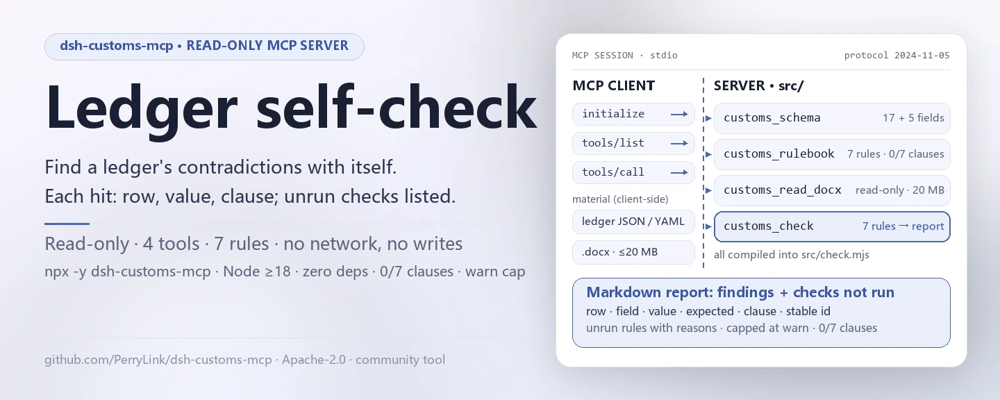
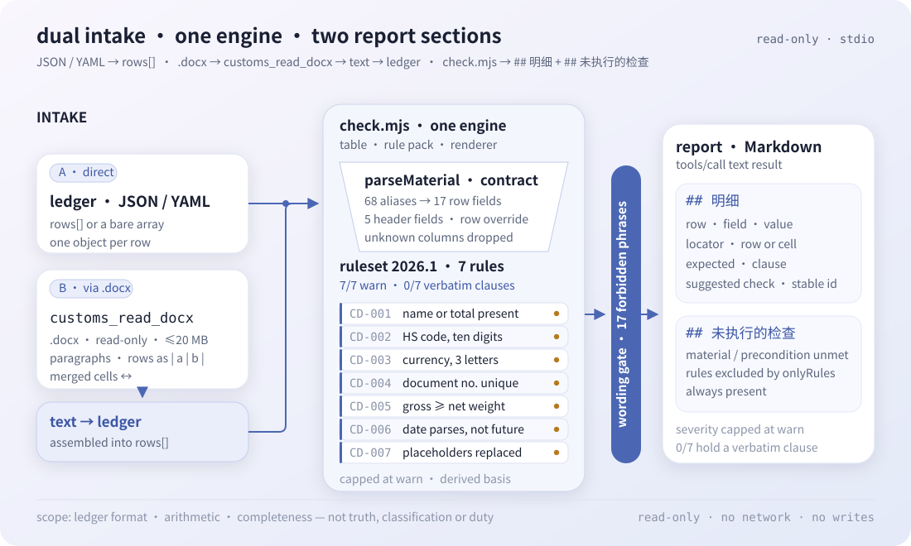

<div align="center">

<picture>
  <source media="(prefers-color-scheme: dark)" srcset="docs/assets/dsh-customs-mcp-hero-en-dark.webp">
  
</picture>

# dsh-customs-mcp

**Surface every row-against-row contradiction in a customs declaration ledger at once — an HS code that is not ten digits, a currency that is not three letters, gross weight below net weight, a document number used twice, a date that does not parse, a template placeholder left unfilled.**

A read-only MCP server: it takes the ledger you already keep (JSON or YAML, one row per document line or goods line), checks that ledger's own format, arithmetic and completeness against a rule pack, and returns a Markdown report with row numbers and clause provenance. It does not decide whether a declaration is correct, whether goods are misclassified, or whether duty is owed.

[Install](#three-step-setup) · [Configuration](#configuration) · [FAQ](#faq) · [简体中文](README.md) · [English](README.en.md) · [Español](README.es.md) · [Português](README.pt.md) · [हिन्दी](README.hi.md)

[](LICENSE)
[](https://www.npmjs.com/package/dsh-customs-mcp)
[](#three-step-setup)

[](https://github.com/PerryLink/dsh-customs-mcp/stargazers)
[](https://www.npmjs.com/package/dsh-customs-mcp)

```sh
npm i -g dsh-customs-mcp   # global install; the command is dsh-customs-mcp
npx -y dsh-customs-mcp     # or run it without installing
```

</div>

<sub>Community tool, not affiliated with DeepSeek. Canonical repository: <https://github.com/PerryLink/dsh-customs-mcp>.</sub>

## What it is

This server does one thing: it takes a customs ledger you have already assembled and checks, row by row, whether the ledger contradicts itself. The input is the ledger itself (`{ "rows": [...] }` or a bare array; JSON and YAML both work). The output is a Markdown report in which every finding carries a row number, the field name, the value found, what the check expected, the clause it rests on and a suggested place to look — and the report always ends with a section listing the checks that did not run, and why.

It does not decide whether a declaration is truthful, whether a classification is right, or whether duty is owed. Those are judgments for customs and for classification specialists, and not making them is deliberate.

<picture>
  <source media="(prefers-color-scheme: dark)" srcset="docs/assets/dsh-customs-mcp-flow-v5-dark.svg">
  
</picture>

## Three-step setup

### 1. Install

```sh
npm i -g dsh-customs-mcp     # global install: the command is dsh-customs-mcp
npx -y dsh-customs-mcp       # or no install: npx runs it straight away
```

Zero runtime dependencies (there is no `dependencies` key in `package.json`), Node ≥ 18, no credentials, no network, no writes. Any MCP client can use it once installed.

### 2. Quick start

Put it in a client config (the npx form shown):

```json
{
  "mcpServers": {
    "customs": {
      "command": "npx",
      "args": ["-y", "dsh-customs-mcp"]
    }
  }
}
```

The order that works: call `customs_schema` to confirm the column names, paste the ledger in, then call `customs_check` for the report. For a `.docx`, run `customs_read_docx` first to get text, then shape it into a ledger.

### 3. Verify

```sh
printf '%s\n' '{"jsonrpc":"2.0","id":1,"method":"initialize","params":{}}' | npx -y dsh-customs-mcp
```

```
{"jsonrpc":"2.0","id":1,"result":{"protocolVersion":"2024-11-05","capabilities":{"tools":{}},"serverInfo":{"name":"dsh-customs-mcp","version":"0.1.0"}}}
```

Send `tools/list` next and four tools come back; send `customs_rulebook` and `"verbatimClause": 0` is in the response. On Windows you do not have to type JSON-RPC by hand — use the client config from the previous step.

*Observed from `src/index.js:9-23` (stdio transport), `src/server.js:139-154` (the initialize response)*

## Core capabilities

### The four tools

| Tool | Input | Returns | What it does |
|---|---|---|---|
| `customs_check` | `material` (JSON/YAML text, required), `onlyRules` (optional rule-id array) | Markdown report | Runs the rule pack over the ledger and returns findings plus the checks that did not run |
| `customs_read_docx` | `path` (`.docx` path, required) | plain text | One line per paragraph; table rows become pipe-separated cells; merged cells are marked `↔` |
| `customs_schema` | none | JSON | The 17 row fields plus 5 header fields, with every accepted alias |
| `customs_rulebook` | none | JSON | The 7 rules (id / title / severity / basis kind / cited source) plus `coverage` |

All four declare `readOnlyHint: true`, `destructiveHint: false` and `openWorldHint: false`.

### The seven rules

| ID | What it checks | The check the pack declares | Severity |
|---|---|---|---|
| `CD-001` | At least one of goods name / total value is filled | `presenceAny: goodsName, amount` | warn |
| `CD-002` | The HS code is ten digits | `pattern: ^[0-9]{10}$` | warn |
| `CD-003` | The currency is three uppercase letters | `pattern: ^[A-Z]{3}$` | warn |
| `CD-004` | The document number is unique within the ledger | `unique: docNo` (whitespace ignored) | warn |
| `CD-005` | Gross weight is not below net weight | `grossWeight >= netWeight` (units allowed, e.g. `12.5KGS`) | warn |
| `CD-006` | The declaration date parses and is not after the check date | `date: declaredAt, notAfter: today` | warn |
| `CD-007` | The goods name holds no unfilled placeholder | `containsAny`: 11 terms such as `XXX`, `TBD`, `{{`, `}}` | warn |

Rule data and code are separate: each check is a parameter block in the rule pack, so changing the digit count, the pattern or the placeholder list needs no code change.

### How to read the report

- Four header lines: the material checked, the check time, the ruleset version, and the tally (error · warn · info).
- The findings section: each hit carries what was found, what was expected, the clause it rests on, a suggested place to look, and an issue id built from the rule id plus a locator hash — the same hit reproduces the same id.
- The checks-not-executed section: every rule that did not run is listed with the reason. That section is always present; the report is only as complete as that list allows.
- A closing disclaimer: the report is generated by a program from a declared ruleset, lists literal differences from the cited clauses, and is meant as a lead for human review.
- **A wording gate.** The renderer scans its own output against a list of forbidden adjudicating words (the Chinese equivalents of *compliant*, *non-compliant*, *illegal*, *passed acceptance*). If one appears, it throws instead of emitting a report.

The two literal section headings are Chinese, because the report language is fixed:

```text
## 明细
## 未执行的检查
```

### The honest part

Every rule states what it rests on, and **0 of the 7 currently hold the verbatim clause text**. The pack says so itself: such a rule's excerpt reads “the clause text was not obtained this time” rather than paraphrasing a regulation the author could not read.

`customs_rulebook` reports that coverage as a **computed number**, not as a claim:

```json
"coverage": {
  "rules": 7,
  "verbatimClause": 0,
  "uncited": 7,
  "bySeverity": { "warn": 7 },
  "byBasisKind": { "derived-from-principle": 7 }
}
```

`verbatimClause: false` means the pack states it could not obtain the clause text — it does **not** mean the check has no basis, and this server does not upgrade a derived rule to a stated one. So the checks are format and arithmetic consistency, capped at `warn`, and the report names which of them did not run at all.

### Example

Input (one ledger row; `test/fixtures/ledger-bad.json` holds a three-row bad sample):

```json
{
  "declarationNo": "530120260000123456",
  "rows": [
    { "单证编号": "INV-2026-001", "商品编号": "84713000", "品名": "笔记本电脑",
      "总价": "50000", "币制": "USD", "毛重": "10", "净重": "12", "申报日期": "2026-02-31" }
  ]
}
```

Output (the findings section; the clause, suggested-fix and issue-id lines are elided here):

```
- **[提示] CD-002** — 第1行数据
  - 实际：第 1 行「hsCode」的值「84713000」不符合配置的形式
  - 依据要求：「hsCode」应匹配 ^[0-9]{10}$

- **[提示] CD-005** — 第1行数据
  - 实际：第 1 行「grossWeight」为 10，「netWeight」为 12，不满足不小于关系
  - 依据要求：「grossWeight」应不小于「netWeight」

- **[提示] CD-006** — 第1行数据
  - 实际：第 1 行「declaredAt」的值「2026-02-31」无法解析为日期
  - 依据要求：「declaredAt」应为 2026-03-15 或 2026-03-15 09:30 这样的可解析日期
```

*Observed from `src/check.mjs:2597-2664` (the report renderer), `src/check.mjs:2666-2672` (the severity ceiling per basis kind)*

## Configuration

This server has no config file, no environment variables and no switches. Two things are configurable: the launch command in your MCP client, and the tool arguments.

| Parameter | Belongs to | Default / accepted value | Meaning |
|---|---|---|---|
| `material` | `customs_check` | required, non-empty string | The ledger body, JSON or YAML: `{ "rows": [...] }` or a bare array |
| `onlyRules` | `customs_check` | omitted = all 7 rules | Run only these rule ids, e.g. `["CD-002"]`; excluded rules appear in the not-executed section |
| `path` | `customs_read_docx` | required, must end in `.docx` | Absolute, or relative to the working directory; that one file is opened read-only |
| Launch command | client config | `npx -y dsh-customs-mcp` or a global `dsh-customs-mcp` | stdio transport, newline-delimited JSON-RPC |
| Protocol version | `initialize` | `2024-11-05` | Returned as `protocolVersion` |
| Per-file limit | `customs_read_docx` | 20 MB | Anything larger is refused with its actual size quoted |
| Env vars / credentials | — | none | No credential is read, no request is made |
| Writes | — | none | The path you pass is opened read-only; `src/` contains no write call |

<details>
<summary>Full column contract (17 row fields + 5 header fields)</summary>

Row fields (one object per row; a field counts as recognised when any of its aliases is present):

| Field | Holds | Used by |
|---|---|---|
| `docKind` | kind of document | — |
| `docNo` | document number | `CD-004` (uniqueness) |
| `hsCode` | HS code | `CD-002` (ten digits) |
| `goodsName` | goods name / description | `CD-001`, `CD-007` |
| `quantity` | quantity | — |
| `unit` | unit of measure | — |
| `unitPrice` | unit price | — |
| `amount` | total value | `CD-001` |
| `currency` | currency code | `CD-003` (three letters) |
| `tradeTerms` | terms of trade | — |
| `origin` | country of origin | — |
| `destination` | final destination country | — |
| `grossWeight` | gross weight | `CD-005` |
| `netWeight` | net weight | `CD-005` |
| `packages` | package count | — |
| `declaredAt` | declaration date | `CD-006` |
| `note` | remark | — |

Header fields (ledger-level scalars; a row-level value of the same field wins):

| Field | Holds |
|---|---|
| `declarationNo` | declaration number |
| `consignee` | domestic consignee |
| `contractNo` | contract number |
| `invoiceNo` | invoice number |
| `declaredAt` | declaration date |

The row-list key may be any of `rows`, `items`, `documents` or the Chinese word for “documents”. A ledger must contain at least one of `declarationNo`, `docNo`, `hsCode` or `goodsName` (their Chinese spellings also count), otherwise the reader refuses it and lists the column names it actually saw.

Every field also answers to several spellings, including the Chinese column headers used on real ledgers. Call `customs_schema` for the exact alias list — it returns the engine's own contract, not a copy maintained in a document.

</details>

## FAQ

<details>
<summary>Does the ledger leave my machine?</summary>

No. `src/` contains no `node:http`, `node:https`, `node:net`, `node:dgram` or `fetch(`, and no `writeFile`, `appendFile`, `createWriteStream`, `rm(` or `unlink` — that no-network, no-writes claim is checked by `test/smoke.mjs` against the **shipped source**, file by file, rather than asserted in prose. The report exists only inside your client session.

</details>

<details>
<summary>None of the seven rules holds a clause text — is the report still worth anything?</summary>

It is a set of leads, not a verdict. The pack pins every rule's basis kind to `derived-from-principle` (inferred from a principle), so severity is capped at `warn` and can never reach `error`; `customs_rulebook`'s `coverage` states “0 of 7 hold a verbatim clause” as a computed number; and the not-executed section names the rules that did not run. Together you can see what each finding rests on, how weak that is, and what was not checked.

</details>

<details>
<summary>Why are PDF, .doc and .wps refused outright?</summary>

A PDF loses the table's cell structure, so a reconstructed ledger is wrong in ways this check cannot detect — worse than no check, which is why it is refused on purpose. `.doc` and `.wps` are a different binary format and are not parsed here. Only a path ending in `.docx` is accepted; convert first, then feed it in.

</details>

<details>
<summary>What happens if a column name is wrong?</summary>

Two cases. If the ledger has no recognisable field at all, the reader refuses it and lists both what it saw and what it looked for. If only some column names are wrong, those columns are silently dropped and the rules that need them stay quiet — the report will not announce the gap. So call `customs_schema` once first.

</details>

<details>
<summary>Will it ever call something compliant or illegal?</summary>

No, and that is enforced: the renderer scans its own output for adjudicating words and throws rather than emitting a report that contains one. Quoted spans and book-title spans are excluded from that scan. The report closes with a disclaimer stating that it lists literal differences and constitutes no finding of fact.

</details>

## Known limitations

- **Everything is capped at `warn`, and 0 of 7 rules hold a verbatim clause.** That is the current state of the rule pack, not a setting; `customs_rulebook` recomputes it on every call.
- **No code tables are bundled.** The code tables for customs districts, currencies, countries, ports, transport modes and supervision modes were not obtained, which is why `CD-003` checks the *shape* (three uppercase letters) and does not choose between `CNY` and `RMB`.
- **Unrecognised column names are dropped silently.** A partly-wrong header does not raise an error; the rules that needed those columns simply report nothing (see the FAQ).
- **Table input only.** You assemble the JSON/YAML ledger yourself; there is no OCR, no PDF parsing and no merging of documents.
- **No substantive judgment.** Whether a declaration is truthful, a classification correct, duty owed or a deadline met is never decided here.

### Safety boundaries

- Table-driven only: the input is a ledger you already have, in JSON or YAML.
- `.docx` is supported through `customs_read_docx`. `.doc` and `.wps` are a different binary format, and PDF is refused on purpose — a PDF table loses its cell structure, and reconstructing it yields a ledger that is wrong in ways the check cannot catch.
- The engine, the rule pack and the table spec are compiled into `src/check.mjs`, so the package installs nothing at runtime.
- Read-only: it reads the one `.docx` path you pass, opens it read-only, and refuses anything over 20 MB. No network, no writes, no credentials.

## Development

```sh
git clone https://github.com/PerryLink/dsh-customs-mcp.git
cd dsh-customs-mcp

node test/smoke.mjs                                # smoke: protocol surface, four tools, manifests, no-network/no-writes
node src/check.mjs --schema                        # the column contract and every alias
node src/check.mjs --rulebook                      # the rules plus coverage
node src/check.mjs test/fixtures/ledger-bad.json   # 6 findings, exit code 1; --json for a structured report

python scripts/gen-readme-assets.py                # regenerate the hero webp images and the structure SVGs in docs/assets (Pillow)
docker build -t dsh-customs-mcp .                  # optional: node:22-alpine image, entry src/index.js
```

There is no `npm install` and no build step: the repo has zero dependencies and `src/` is what ships. The README images are generated by [`scripts/gen-readme-assets.py`](scripts/gen-readme-assets.py) (Pillow draws the hero banners, the structure diagram is hand-written SVG, with a CJK font probe) and the script is safe to re-run.

Layout:

```
src/index.js     stdio transport: a newline-delimited JSON-RPC loop
src/server.js    protocol surface and the four tools (initialize / tools/list / tools/call)
src/check.mjs    engine, rule pack, table spec, bundled into one file; exports COLUMN_CONTRACT, rulebook, renderMarkdown
src/docx.mjs     .docx text extraction: paragraphs, table rows, merged-cell marks
test/smoke.mjs   smoke test: manifest agreement, protocol replies, four tools, refusals, no network, no writes
server.json      MCP registry manifest (name/version kept in step with package.json)
scripts/gen-readme-assets.py  README diagram generator
docs/assets/     light and dark hero images and the structure diagram
```

## Family & thanks

Maintained by [PerryLink](https://github.com/PerryLink) (Apache-2.0), on the same inspection engine as the sibling customs-document checker: `src/check.mjs` is bundled from `dsh-customs-doc-check` (the rule pack header still names `plugin: dsh-customs-doc-check`, and the source keeps its provenance comments). This repo adds the MCP protocol surface, read-only `.docx` extraction and the npm distribution shape. If this server helped you, **give it a star** — it unlocks nothing, but it makes the next person find it.

- [@PerryLink](https://github.com/PerryLink) — creator and maintainer: the MCP protocol surface, read-only `.docx` extraction, packaging of the rule pack and table spec, manifest-agreement smoke test, and the five-language docs.

## License

[LICENSE](LICENSE) (Apache License 2.0) © 2026 dsh-customs-mcp contributors

<p align="center"><sub>Apache-2.0 · Community tool, not affiliated with DeepSeek.</sub></p>
