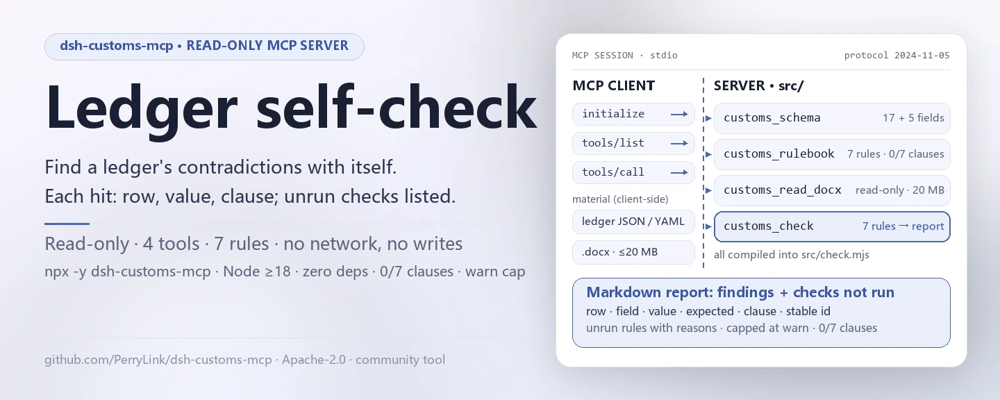
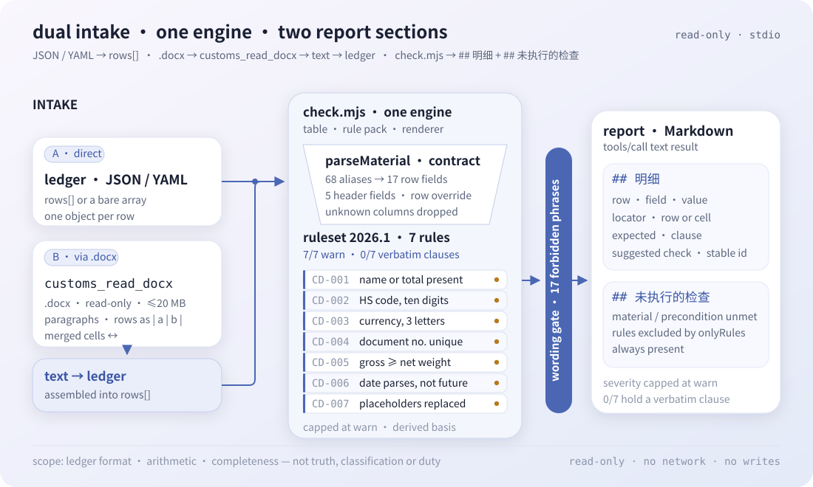

<div align="center">

<picture>
  <source media="(prefers-color-scheme: dark)" srcset="docs/assets/dsh-customs-mcp-hero-en-dark.webp">
  
</picture>

# dsh-customs-mcp

**Saca de una vez todas las contradicciones entre filas de un libro de declaraciones de aduana: un código HS que no tiene diez dígitos, una moneda que no son tres letras, un peso bruto menor que el neto, un número de documento repetido, una fecha que no se puede interpretar, una plantilla sin rellenar.**

Servidor MCP de solo lectura: recibe el libro que ya tienes (JSON o YAML, una fila por línea de documento o de mercancía), comprueba su propio formato, su aritmética y su completitud contra un paquete de reglas, y devuelve un informe Markdown con número de fila y procedencia de la cláusula. No decide si la declaración es correcta, si la clasificación es adecuada ni si hay derechos que pagar.

[Instalar](#instalación-en-tres-pasos) · [Configuración](#configuración) · [FAQ](#faq) · [简体中文](README.md) · [English](README.en.md) · [Español](README.es.md) · [Português](README.pt.md) · [हिन्दी](README.hi.md)

[](LICENSE)
[](https://www.npmjs.com/package/dsh-customs-mcp)
[](#instalación-en-tres-pasos)

[](https://github.com/PerryLink/dsh-customs-mcp/stargazers)
[](https://www.npmjs.com/package/dsh-customs-mcp)

```sh
npm i -g dsh-customs-mcp   # instalación global; el comando es dsh-customs-mcp
npx -y dsh-customs-mcp     # o ejecutarlo sin instalar nada
```

</div>

<sub>Herramienta de la comunidad, no afiliada a DeepSeek. Repositorio canónico: <https://github.com/PerryLink/dsh-customs-mcp>.</sub>

## Qué es

El servidor hace una sola cosa: toma un libro de aduanas que ya has montado y comprueba, fila por fila, si el libro se contradice a sí mismo. La entrada es el libro (`{ "rows": [...] }` o un array plano; JSON y YAML valen igual). La salida es un informe Markdown en el que cada hallazgo lleva número de fila, nombre de campo, valor encontrado, lo que la comprobación esperaba, la cláusula en la que se apoya y una sugerencia de dónde mirar; el informe termina siempre con una sección que enumera las comprobaciones que no se ejecutaron y por qué.

No decide si una declaración es veraz, si una clasificación es correcta ni si hay derechos que pagar. Eso corresponde a la aduana y a los especialistas en clasificación, y no decidirlo es deliberado.

<picture>
  <source media="(prefers-color-scheme: dark)" srcset="docs/assets/dsh-customs-mcp-flow-v5-dark.svg">
  
</picture>

## Instalación en tres pasos

### 1. Instalar

```sh
npm i -g dsh-customs-mcp     # instalación global: el comando es dsh-customs-mcp
npx -y dsh-customs-mcp       # o sin instalar: npx lo ejecuta directamente
```

Cero dependencias en tiempo de ejecución (no hay clave `dependencies` en `package.json`), Node ≥ 18, sin credenciales, sin red, sin escrituras. Cualquier cliente MCP puede usarlo una vez instalado.

### 2. Uso rápido

En la configuración del cliente (forma con npx):

```json
{
  "mcpServers": {
    "customs": {
      "command": "npx",
      "args": ["-y", "dsh-customs-mcp"]
    }
  }
}
```

El orden que funciona: `customs_schema` para confirmar los nombres de columna, pegar el libro y luego `customs_check` para el informe. Con un `.docx`, primero `customs_read_docx` para obtener texto y después darle forma de libro.

### 3. Verificar

```sh
printf '%s\n' '{"jsonrpc":"2.0","id":1,"method":"initialize","params":{}}' | npx -y dsh-customs-mcp
```

```
{"jsonrpc":"2.0","id":1,"result":{"protocolVersion":"2024-11-05","capabilities":{"tools":{}},"serverInfo":{"name":"dsh-customs-mcp","version":"0.1.0"}}}
```

Envía después `tools/list` y aparecen las cuatro herramientas; envía `customs_rulebook` y la respuesta trae `"verbatimClause": 0`. En Windows no hace falta escribir JSON-RPC a mano: basta con la configuración del paso anterior.

*Observed from `src/index.js:9-23` (transporte stdio), `src/server.js:139-154` (respuesta a initialize)*

## Capacidades clave

### Las cuatro herramientas

| Herramienta | Entrada | Devuelve | Qué hace |
|---|---|---|---|
| `customs_check` | `material` (texto JSON/YAML, obligatorio), `onlyRules` (array opcional de ids) | informe Markdown | Aplica el paquete de reglas al libro y devuelve hallazgos más las comprobaciones no ejecutadas |
| `customs_read_docx` | `path` (ruta `.docx`, obligatorio) | texto plano | Un párrafo por línea; las filas de tabla salen como celdas separadas por barras; las celdas combinadas se marcan `↔` |
| `customs_schema` | ninguno | JSON | Los 17 campos de fila y los 5 de cabecera, con todos los alias aceptados |
| `customs_rulebook` | ninguno | JSON | Las 7 reglas (id / título / gravedad / tipo de fundamento / fuente citada) más `coverage` |

Las cuatro declaran `readOnlyHint: true`, `destructiveHint: false` y `openWorldHint: false`.

### Las siete reglas

| ID | Qué comprueba | Comprobación declarada | Gravedad |
|---|---|---|---|
| `CD-001` | Hay al menos nombre de mercancía o valor total | `presenceAny: goodsName, amount` | warn |
| `CD-002` | El código HS tiene diez dígitos | `pattern: ^[0-9]{10}$` | warn |
| `CD-003` | La moneda son tres letras mayúsculas | `pattern: ^[A-Z]{3}$` | warn |
| `CD-004` | El número de documento es único en el libro | `unique: docNo` (ignora espacios) | warn |
| `CD-005` | El peso bruto no es menor que el neto | `grossWeight >= netWeight` (admite unidades, p. ej. `12.5KGS`) | warn |
| `CD-006` | La fecha de declaración se interpreta y no es posterior a la fecha de control | `date: declaredAt, notAfter: today` | warn |
| `CD-007` | El nombre de mercancía no conserva marcadores sin rellenar | `containsAny`: 11 términos como `XXX`, `TBD`, `{{`, `}}` | warn |

Datos y código están separados: cada comprobación es un bloque de parámetros del paquete de reglas, así que cambiar el número de dígitos, el patrón o la lista de marcadores no exige tocar código.

### Cómo leer el informe

- Cuatro líneas de cabecera: material comprobado, fecha de la comprobación, versión del conjunto de reglas y recuento (error · aviso · referencia).
- La sección de hallazgos: cada uno lleva lo encontrado, lo esperado, la cláusula en la que se apoya, una sugerencia y un id de incidencia formado por el id de la regla más un hash de localización; el mismo hallazgo reproduce el mismo id.
- La sección de comprobaciones no ejecutadas: cada regla que no corrió aparece con su motivo. Esa sección siempre está; el informe solo es tan completo como permite esa lista.
- Un descargo final: el informe lo genera un programa a partir de un conjunto de reglas declarado, solo enumera diferencias literales frente a las cláusulas citadas y sirve como pista para revisión humana.
- **Una barrera de redacción.** El renderizador escanea su propia salida contra una lista de palabras decisorias prohibidas (equivalentes en chino de *conforme*, *no conforme*, *ilegal*, *superó la inspección*). Si aparece una, lanza un error en vez de emitir el informe.

Los dos títulos de sección son literales en chino, porque el idioma del informe es fijo:

```text
## 明细
## 未执行的检查
```

### La parte honesta

Cada regla declara en qué se apoya, y **0 de las 7 conservan hoy el texto literal de la cláusula**. Lo dice el propio paquete: el extracto de esas reglas reza «esta vez no se obtuvo el texto de la cláusula» en lugar de parafrasear una norma que el autor no pudo leer.

`customs_rulebook` informa de esa cobertura como un **número calculado**, no como una afirmación:

```json
"coverage": {
  "rules": 7,
  "verbatimClause": 0,
  "uncited": 7,
  "bySeverity": { "warn": 7 },
  "byBasisKind": { "derived-from-principle": 7 }
}
```

`verbatimClause: false` significa que el paquete declara no haber obtenido el texto de la cláusula; **no** significa que la comprobación carezca de fundamento, y este servidor no eleva una regla derivada a regla literal. Por eso las comprobaciones son de formato y de aritmética, con gravedad máxima `warn`, y el informe nombra cuáles no llegaron a ejecutarse.

### Ejemplo

Entrada (una fila; `test/fixtures/ledger-bad.json` contiene una muestra mala de tres filas):

```json
{
  "declarationNo": "530120260000123456",
  "rows": [
    { "单证编号": "INV-2026-001", "商品编号": "84713000", "品名": "笔记本电脑",
      "总价": "50000", "币制": "USD", "毛重": "10", "净重": "12", "申报日期": "2026-02-31" }
  ]
}
```

Salida (la sección de hallazgos; aquí se omiten las líneas de cláusula, sugerencia e id):

```
- **[提示] CD-002** — 第1行数据
  - 实际：第 1 行「hsCode」的值「84713000」不符合配置的形式
  - 依据要求：「hsCode」应匹配 ^[0-9]{10}$

- **[提示] CD-005** — 第1行数据
  - 实际：第 1 行「grossWeight」为 10，「netWeight」为 12，不满足不小于关系
  - 依据要求：「grossWeight」应不小于「netWeight」

- **[提示] CD-006** — 第1行数据
  - 实际：第 1 行「declaredAt」的值「2026-02-31」无法解析为日期
  - 依据要求：「declaredAt」应为 2026-03-15 或 2026-03-15 09:30 这样的可解析日期
```

*Observed from `src/check.mjs:2597-2664` (el renderizador del informe), `src/check.mjs:2666-2672` (el techo de gravedad por tipo de fundamento)*

## Configuración

Este servidor no tiene archivo de configuración, ni variables de entorno, ni interruptores. Solo se configuran dos cosas: el comando de arranque en el cliente MCP y los argumentos de las herramientas.

| Parámetro | Pertenece a | Valor por defecto / admitido | Significado |
|---|---|---|---|
| `material` | `customs_check` | obligatorio, cadena no vacía | El cuerpo del libro, JSON o YAML: `{ "rows": [...] }` o array plano |
| `onlyRules` | `customs_check` | omitido = las 7 reglas | Ejecutar solo estos ids, p. ej. `["CD-002"]`; las excluidas aparecen en la sección de no ejecutadas |
| `path` | `customs_read_docx` | obligatorio, debe acabar en `.docx` | Ruta absoluta o relativa al directorio de trabajo; solo se abre ese archivo, en solo lectura |
| Comando de arranque | configuración del cliente | `npx -y dsh-customs-mcp` o `dsh-customs-mcp` global | Transporte stdio, JSON-RPC separado por saltos de línea |
| Versión del protocolo | `initialize` | `2024-11-05` | Se devuelve como `protocolVersion` |
| Límite por archivo | `customs_read_docx` | 20 MB | Lo que supere ese tamaño se rechaza indicando el tamaño real |
| Variables de entorno / credenciales | — | ninguna | No se lee credencial alguna, no se hace ninguna petición |
| Escrituras | — | ninguna | La ruta indicada se abre en solo lectura; `src/` no contiene llamadas de escritura |

<details>
<summary>Contrato completo de columnas (17 campos de fila + 5 de cabecera)</summary>

Campos de fila (un objeto por fila; un campo se reconoce cuando aparece cualquiera de sus alias):

| Campo | Contiene | Lo usa |
|---|---|---|
| `docKind` | tipo de documento | — |
| `docNo` | número de documento | `CD-004` (unicidad) |
| `hsCode` | código HS | `CD-002` (diez dígitos) |
| `goodsName` | nombre de la mercancía | `CD-001`, `CD-007` |
| `quantity` | cantidad | — |
| `unit` | unidad de medida | — |
| `unitPrice` | precio unitario | — |
| `amount` | valor total | `CD-001` |
| `currency` | código de moneda | `CD-003` (tres letras) |
| `tradeTerms` | condiciones de comercio | — |
| `origin` | país de origen | — |
| `destination` | país de destino final | — |
| `grossWeight` | peso bruto | `CD-005` |
| `netWeight` | peso neto | `CD-005` |
| `packages` | número de bultos | — |
| `declaredAt` | fecha de declaración | `CD-006` |
| `note` | observaciones | — |

Campos de cabecera (escalares de todo el libro; el valor de fila del mismo campo tiene prioridad):

| Campo | Contiene |
|---|---|
| `declarationNo` | número de declaración |
| `consignee` | consignatario nacional |
| `contractNo` | número de contrato |
| `invoiceNo` | número de factura |
| `declaredAt` | fecha de declaración |

La clave de la lista de filas puede ser `rows`, `items`, `documents` o la palabra china equivalente. El libro debe contener al menos uno de `declarationNo`, `docNo`, `hsCode` o `goodsName` (sus formas en chino también cuentan); si no, el lector lo rechaza y enumera los nombres de columna que sí vio.

Cada campo responde además a varias grafías, incluidas las cabeceras en chino que aparecen en libros reales. Llama a `customs_schema` para la lista exacta de alias: devuelve el contrato del propio motor, no una copia mantenida en un documento.

</details>

## FAQ

<details>
<summary>¿El libro sale de mi máquina?</summary>

No. En `src/` no hay `node:http`, `node:https`, `node:net`, `node:dgram` ni `fetch(`, y tampoco `writeFile`, `appendFile`, `createWriteStream`, `rm(` ni `unlink`: esa afirmación de «sin red, sin escrituras» la verifica `test/smoke.mjs` sobre el **código que se publica**, archivo por archivo, no es una promesa en prosa. El informe solo existe dentro de la sesión de tu cliente.

</details>

<details>
<summary>Si ninguna de las siete reglas conserva el texto de la cláusula, ¿sirve de algo el informe?</summary>

Es un conjunto de pistas, no un veredicto. El paquete fija el tipo de fundamento de cada regla en `derived-from-principle` (inferido de un principio), así que la gravedad máxima es `warn` y nunca llega a `error`; el `coverage` de `customs_rulebook` da el «0 de 7 con texto literal» como número calculado; y la sección de no ejecutadas enumera las reglas que no corrieron. Con eso ves en qué se apoya cada hallazgo, cuán débil es y qué no se comprobó.

</details>

<details>
<summary>¿Por qué rechaza directamente PDF, .doc y .wps?</summary>

Un PDF pierde la estructura de celdas de la tabla, así que un libro reconstruido está mal de formas que esta comprobación no puede detectar: peor que no comprobar, y por eso se rechaza a propósito. `.doc` y `.wps` son otro formato binario y no se interpretan aquí. Solo se acepta una ruta que acabe en `.docx`; convierte primero y luego pásalo.

</details>

<details>
<summary>¿Qué pasa si un nombre de columna está mal?</summary>

Dos casos. Si el libro no tiene ningún campo reconocible, el lector lo rechaza y enumera tanto lo que vio como lo que buscaba. Si solo algunos nombres están mal, esas columnas se descartan en silencio y las reglas que las necesitan no dicen nada: el informe no anunciará el hueco. Por eso conviene llamar antes a `customs_schema`.

</details>

<details>
<summary>¿Va a decir alguna vez que algo es conforme o ilegal?</summary>

No, y está forzado: el renderizador escanea su propia salida y lanza un error en lugar de emitir un informe que contenga una palabra decisoria. Los tramos entre comillas y entre títulos de obra quedan fuera de ese escaneo. El informe cierra con un descargo que declara que solo enumera diferencias literales y no constituye una calificación de los hechos.

</details>

## Limitaciones conocidas

- **Todo se queda en `warn`, y 0 de 7 reglas conservan el texto literal de la cláusula.** Es el estado actual del paquete de reglas, no un ajuste; `customs_rulebook` lo recalcula en cada llamada.
- **No se incluye ninguna tabla de códigos.** No se obtuvieron las tablas de distritos aduaneros, monedas, países, puertos, modos de transporte ni regímenes de supervisión, y por eso `CD-003` comprueba la *forma* (tres letras mayúsculas) y no elige entre `CNY` y `RMB`.
- **Los nombres de columna no reconocidos se descartan en silencio.** Una cabecera parcialmente errónea no da error; las reglas que necesitaban esas columnas simplemente no informan (ver FAQ).
- **Solo entrada tabular.** El libro JSON/YAML lo montas tú; no hay OCR, ni lectura de PDF, ni fusión de documentos.
- **Ningún juicio sustantivo.** Aquí nunca se decide si una declaración es veraz, si una clasificación es correcta, si hay derechos que pagar o si se cumplió un plazo.

### Límites de seguridad

- Solo tablas: la entrada es un libro que ya tienes, en JSON o YAML.
- `.docx` se admite mediante `customs_read_docx`. `.doc` y `.wps` son otro formato binario, y el PDF se rechaza a propósito: una tabla en PDF pierde la estructura de celdas y reconstruirla produce un libro equivocado de formas que la comprobación no puede detectar.
- El motor, el paquete de reglas y la especificación de la tabla van compilados en `src/check.mjs`, así que el paquete no instala nada en tiempo de ejecución.
- Solo lectura: abre la única ruta `.docx` que le pasas, en modo lectura, y rechaza cualquier cosa por encima de 20 MB. Sin red, sin escrituras, sin credenciales.

## Desarrollo

```sh
git clone https://github.com/PerryLink/dsh-customs-mcp.git
cd dsh-customs-mcp

node test/smoke.mjs                                # humo: superficie del protocolo, cuatro herramientas, manifiestos, sin red ni escrituras
node src/check.mjs --schema                        # el contrato de columnas y todos los alias
node src/check.mjs --rulebook                      # las reglas y la cobertura
node src/check.mjs test/fixtures/ledger-bad.json   # 6 hallazgos, código de salida 1; --json para informe estructurado

python scripts/gen-readme-assets.py                # regenera los hero webp y los SVG de estructura en docs/assets (Pillow)
docker build -t dsh-customs-mcp .                  # opcional: imagen node:22-alpine, entrada src/index.js
```

No hay `npm install` ni paso de compilación: el repositorio no tiene dependencias y `src/` es lo que se publica. Las imágenes del README las genera [`scripts/gen-readme-assets.py`](scripts/gen-readme-assets.py) (Pillow dibuja los hero, la estructura es SVG escrito a mano y hay una sonda de fuente CJK) y se puede volver a ejecutar sin riesgo.

Estructura:

```
src/index.js     transporte stdio: bucle JSON-RPC separado por saltos de línea
src/server.js    superficie del protocolo y las cuatro herramientas (initialize / tools/list / tools/call)
src/check.mjs    motor, paquete de reglas y especificación de tabla en un solo archivo; exporta COLUMN_CONTRACT, rulebook y renderMarkdown
src/docx.mjs     extracción de texto .docx: párrafos, filas de tabla, marcas de celda combinada
test/smoke.mjs   prueba de humo: manifiestos, respuestas del protocolo, cuatro herramientas, rechazos, sin red ni escrituras
server.json      manifiesto del registro MCP (name/version alineados con package.json)
scripts/gen-readme-assets.py  generador de los diagramas del README
docs/assets/     hero claro/oscuro y diagrama de estructura
```

## Familia y agradecimientos

Mantenido por [PerryLink](https://github.com/PerryLink) (Apache-2.0), sobre el mismo motor de inspección que el verificador hermano de documentos de aduana: `src/check.mjs` se empaqueta desde `dsh-customs-doc-check` (la cabecera del paquete de reglas sigue nombrando `plugin: dsh-customs-doc-check` y el código conserva sus comentarios de procedencia). Este repositorio añade la superficie del protocolo MCP, la extracción `.docx` de solo lectura y la forma de distribución en npm. Si este servidor te ha servido, **dale una estrella**: no desbloquea nada, pero hace que la siguiente persona lo encuentre.

- [@PerryLink](https://github.com/PerryLink) — creador y mantenedor: la superficie del protocolo MCP, la extracción `.docx` de solo lectura, el empaquetado del paquete de reglas y de la especificación de tabla, la prueba de humo de manifiestos y la documentación en cinco idiomas.

## Licencia

[LICENSE](LICENSE) (Apache License 2.0) © 2026 dsh-customs-mcp contributors

<p align="center"><sub>Apache-2.0 · Herramienta de la comunidad, no afiliada a DeepSeek.</sub></p>
