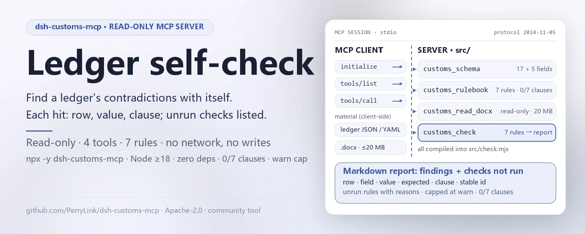
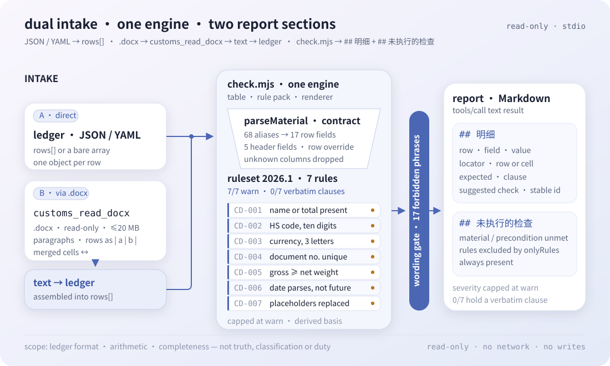

<div align="center">

<picture>
  <source media="(prefers-color-scheme: dark)" srcset="docs/assets/dsh-customs-mcp-hero-en-dark.webp">
  
</picture>

# dsh-customs-mcp

**सीमा शुल्क घोषणा बहीखाते में पंक्ति-दर-पंक्ति विरोधाभास एक बार में पकड़ें — HS कोड दस अंकों का नहीं, मुद्रा तीन अक्षरों की नहीं, सकल भार शुद्ध भार से कम, दस्तावेज़ संख्या दो बार, तारीख़ पढ़ी नहीं जा सकती, टेम्पलेट का प्लेसहोल्डर भरा नहीं गया।**

केवल-पढ़ने वाला MCP सर्वर: आपका पहले से तैयार बहीखाता (JSON या YAML, प्रति दस्तावेज़ या माल पंक्ति एक पंक्ति) लेता है, उसी बहीखाते का प्रारूप, अंकगणित और पूर्णता एक नियम-पैक के सामने जाँचता है, और पंक्ति संख्या तथा धारा-स्रोत सहित Markdown रिपोर्ट लौटाता है। यह तय नहीं करता कि घोषणा सही है, वर्गीकरण उपयुक्त है, या शुल्क बकाया है।

[इंस्टॉल](#तीन-चरणों-में-शुरुआत) · [कॉन्फ़िगरेशन](#कॉन्फ़िगरेशन) · [FAQ](#faq) · [简体中文](README.md) · [English](README.en.md) · [Español](README.es.md) · [Português](README.pt.md) · [हिन्दी](README.hi.md)

[](LICENSE)
[](https://www.npmjs.com/package/dsh-customs-mcp)
[](#तीन-चरणों-में-शुरुआत)

[](https://github.com/PerryLink/dsh-customs-mcp/stargazers)
[](https://www.npmjs.com/package/dsh-customs-mcp)

```sh
npm i -g dsh-customs-mcp   # ग्लोबल इंस्टॉल; कमांड dsh-customs-mcp है
npx -y dsh-customs-mcp     # या बिना इंस्टॉल किए सीधे चलाएँ
```

</div>

<sub>सामुदायिक टूल, DeepSeek से असंबद्ध। कैनोनिकल रिपॉज़िटरी: <https://github.com/PerryLink/dsh-customs-mcp>।</sub>

## यह क्या है

यह सर्वर एक ही काम करता है: आपका बनाया हुआ सीमा शुल्क बहीखाता लेकर पंक्ति-दर-पंक्ति जाँचता है कि बहीखाता अपने ही विरुद्ध है या नहीं। इनपुट बहीखाता ही है (`{ "rows": [...] }` या सीधा array; JSON और YAML दोनों चलते हैं)। आउटपुट एक Markdown रिपोर्ट है जिसमें हर निष्कर्ष के साथ पंक्ति संख्या, फ़ील्ड नाम, मिला हुआ मान, जाँच की अपेक्षा, जिस धारा पर वह टिका है, और कहाँ देखें इसका सुझाव होता है; रिपोर्ट के अंत में हमेशा वह खंड आता है जो बताता है कि कौन-सी जाँचें चली ही नहीं और क्यों।

यह तय नहीं करता कि घोषणा सच है, वर्गीकरण सही है, या शुल्क बकाया है। वे फ़ैसले सीमा शुल्क और वर्गीकरण विशेषज्ञों के हैं, और उन्हें न करना जानबूझकर है।

<picture>
  <source media="(prefers-color-scheme: dark)" srcset="docs/assets/dsh-customs-mcp-flow-v5-dark.svg">
  
</picture>

## तीन चरणों में शुरुआत

### 1. इंस्टॉल करें

```sh
npm i -g dsh-customs-mcp     # ग्लोबल इंस्टॉल: कमांड dsh-customs-mcp है
npx -y dsh-customs-mcp       # या बिना इंस्टॉल: npx सीधे चला देता है
```

रनटाइम पर शून्य निर्भरता (`package.json` में `dependencies` कुंजी ही नहीं है), Node ≥ 18, कोई क्रेडेंशियल नहीं, कोई नेटवर्क नहीं, कोई लेखन नहीं। इंस्टॉल के बाद कोई भी MCP क्लाइंट इसे इस्तेमाल कर सकता है।

### 2. त्वरित उपयोग

क्लाइंट कॉन्फ़िग में डालें (npx रूप):

```json
{
  "mcpServers": {
    "customs": {
      "command": "npx",
      "args": ["-y", "dsh-customs-mcp"]
    }
  }
}
```

काम करने वाला क्रम: `customs_schema` से कॉलम नाम पक्के करें, बहीखाता चिपकाएँ, फिर `customs_check` से रिपोर्ट लें। `.docx` हो तो पहले `customs_read_docx` से टेक्स्ट निकालें, फिर उसे बहीखाते का रूप दें।

### 3. सत्यापित करें

```sh
printf '%s\n' '{"jsonrpc":"2.0","id":1,"method":"initialize","params":{}}' | npx -y dsh-customs-mcp
```

```
{"jsonrpc":"2.0","id":1,"result":{"protocolVersion":"2024-11-05","capabilities":{"tools":{}},"serverInfo":{"name":"dsh-customs-mcp","version":"0.1.0"}}}
```

इसके बाद `tools/list` भेजें तो चारों टूल दिखेंगे; `customs_rulebook` भेजें तो जवाब में `"verbatimClause": 0` मिलेगा। Windows पर JSON-RPC हाथ से लिखने की ज़रूरत नहीं — पिछले चरण का क्लाइंट कॉन्फ़िग इस्तेमाल करें।

*Observed from `src/index.js:9-23` (stdio ट्रांसपोर्ट), `src/server.js:139-154` (initialize का जवाब)*

## मुख्य क्षमताएँ

### चारों टूल

| टूल | इनपुट | लौटाता है | क्या करता है |
|---|---|---|---|
| `customs_check` | `material` (JSON/YAML टेक्स्ट, अनिवार्य), `onlyRules` (वैकल्पिक नियम-id array) | Markdown रिपोर्ट | नियम-पैक बहीखाते पर चलाकर निष्कर्ष और न चलाई गई जाँचें देता है |
| `customs_read_docx` | `path` (`.docx` पथ, अनिवार्य) | सादा टेक्स्ट | प्रति अनुच्छेद एक पंक्ति; तालिका की पंक्तियाँ बार-विभाजित सेल बनती हैं; मर्ज किए सेल `↔` से चिह्नित होते हैं |
| `customs_schema` | कोई नहीं | JSON | 17 पंक्ति-फ़ील्ड और 5 हेडर-फ़ील्ड, हर स्वीकार्य उपनाम के साथ |
| `customs_rulebook` | कोई नहीं | JSON | 7 नियम (id / शीर्षक / गंभीरता / आधार-प्रकार / उद्धृत स्रोत) और `coverage` |

चारों `readOnlyHint: true`, `destructiveHint: false` और `openWorldHint: false` घोषित करते हैं।

### सात नियम

| ID | क्या जाँचता है | घोषित जाँच | गंभीरता |
|---|---|---|---|
| `CD-001` | माल का नाम या कुल मूल्य में से कम-से-कम एक भरा है | `presenceAny: goodsName, amount` | warn |
| `CD-002` | HS कोड दस अंकों का है | `pattern: ^[0-9]{10}$` | warn |
| `CD-003` | मुद्रा तीन बड़े अक्षरों की है | `pattern: ^[A-Z]{3}$` | warn |
| `CD-004` | दस्तावेज़ संख्या बहीखाते में अद्वितीय है | `unique: docNo` (खाली स्थान अनदेखा) | warn |
| `CD-005` | सकल भार शुद्ध भार से कम नहीं है | `grossWeight >= netWeight` (इकाई चलेगी, जैसे `12.5KGS`) | warn |
| `CD-006` | घोषणा तिथि पढ़ी जा सकती है और जाँच-तिथि के बाद की नहीं है | `date: declaredAt, notAfter: today` | warn |
| `CD-007` | माल के नाम में अपूर्ण प्लेसहोल्डर नहीं बचा है | `containsAny`: `XXX`, `TBD`, `{{`, `}}` जैसे 11 शब्द | warn |

नियम-डेटा और कोड अलग हैं: हर जाँच नियम-पैक का एक पैरामीटर ब्लॉक है, इसलिए अंकों की संख्या, पैटर्न या प्लेसहोल्डर सूची बदलने के लिए कोड छूने की ज़रूरत नहीं।

### रिपोर्ट कैसे पढ़ें

- चार हेडर पंक्तियाँ: जाँचा गया बहीखाता, जाँच का समय, नियम-संग्रह का संस्करण, और गिनती (त्रुटि · चेतावनी · संदर्भ)।
- निष्कर्ष खंड: हर निष्कर्ष में मिला हुआ मान, अपेक्षा, आधार धारा, सुझाव, और नियम id तथा स्थान-हैश से बना इश्यू id होता है; वही निष्कर्ष वही id दोहराता है।
- न चलाई गई जाँचें खंड: जो नियम नहीं चले, वे कारण सहित सूचीबद्ध होते हैं। यह खंड हमेशा रहता है; रिपोर्ट उतनी ही पूरी है जितनी वह सूची अनुमति देती है।
- अंत में अस्वीकरण: रिपोर्ट किसी घोषित नियम-संग्रह से प्रोग्राम द्वारा बनी है, केवल उद्धृत धाराओं से शाब्दिक अंतर गिनाती है, और मानवीय पुनरीक्षण के संकेत के रूप में है।
- **शब्दों पर रोक।** रेंडरर अपने ही आउटपुट को निर्णायक शब्दों की निषिद्ध सूची से मिलाता है (चीनी में *अनुरूप*, *अनुरूप नहीं*, *अवैध*, *निरीक्षण पास*)। कोई ऐसा शब्द दिखे तो वह रिपोर्ट देने के बजाय त्रुटि फेंकता है।

रिपोर्ट के दो खंड-शीर्षक चीनी में ही रहते हैं, क्योंकि रिपोर्ट की भाषा स्थिर है:

```text
## 明细
## 未执行的检查
```

### ईमानदार हिस्सा

हर नियम बताता है कि वह किस पर टिका है, और **7 में से आज 0 के पास धारा का शब्दशः पाठ है**। यह बात नियम-पैक स्वयं कहता है: ऐसे नियम का excerpt «इस बार धारा का पाठ नहीं मिला» लिखता है, न कि उस विनियम की परोक्ष व्याख्या जिसे लेखक पढ़ नहीं सका।

`customs_rulebook` इस कवरेज को **गणना किया हुआ आँकड़ा** बताता है, दावा नहीं:

```json
"coverage": {
  "rules": 7,
  "verbatimClause": 0,
  "uncited": 7,
  "bySeverity": { "warn": 7 },
  "byBasisKind": { "derived-from-principle": 7 }
}
```

`verbatimClause: false` का अर्थ है कि नियम-पैक कहता है कि उसे धारा का पाठ नहीं मिला — इसका अर्थ यह **नहीं** कि जाँच का कोई आधार नहीं, और यह सर्वर किसी व्युत्पन्न नियम को शब्दशः नियम में नहीं बढ़ाता। इसलिए ये जाँचें प्रारूप और अंकगणित की संगति हैं, गंभीरता अधिकतम `warn`, और रिपोर्ट नाम लेकर बताती है कि कौन-सी जाँचें चली ही नहीं।

### उदाहरण

इनपुट (एक पंक्ति; `test/fixtures/ledger-bad.json` में तीन पंक्तियों का खराब नमूना है):

```json
{
  "declarationNo": "530120260000123456",
  "rows": [
    { "单证编号": "INV-2026-001", "商品编号": "84713000", "品名": "笔记本电脑",
      "总价": "50000", "币制": "USD", "毛重": "10", "净重": "12", "申报日期": "2026-02-31" }
  ]
}
```

आउटपुट (निष्कर्ष खंड; धारा, सुझाव और id की पंक्तियाँ यहाँ छोड़ी गई हैं):

```
- **[提示] CD-002** — 第1行数据
  - 实际：第 1 行「hsCode」的值「84713000」不符合配置的形式
  - 依据要求：「hsCode」应匹配 ^[0-9]{10}$

- **[提示] CD-005** — 第1行数据
  - 实际：第 1 行「grossWeight」为 10，「netWeight」为 12，不满足不小于关系
  - 依据要求：「grossWeight」应不小于「netWeight」

- **[提示] CD-006** — 第1行数据
  - 实际：第 1 行「declaredAt」的值「2026-02-31」无法解析为日期
  - 依据要求：「declaredAt」应为 2026-03-15 或 2026-03-15 09:30 这样的可解析日期
```

*Observed from `src/check.mjs:2597-2664` (रिपोर्ट रेंडरर), `src/check.mjs:2666-2672` (आधार-प्रकार के अनुसार गंभीरता की ऊपरी सीमा)*

## कॉन्फ़िगरेशन

इस सर्वर का न कोई कॉन्फ़िग फ़ाइल है, न एनवायरनमेंट वैरिएबल, न कोई स्विच। केवल दो चीज़ें सेट होती हैं: MCP क्लाइंट में शुरुआती कमांड, और टूल के आर्ग्युमेंट।

| पैरामीटर | किसका | डिफ़ॉल्ट / स्वीकार्य मान | अर्थ |
|---|---|---|---|
| `material` | `customs_check` | अनिवार्य, खाली नहीं | बहीखाते का मुख्य भाग, JSON या YAML: `{ "rows": [...] }` या सीधा array |
| `onlyRules` | `customs_check` | छोड़ दें = सातों नियम | केवल ये नियम चलाएँ, जैसे `["CD-002"]`; छोड़े गए नियम न-चली-जाँच खंड में जाते हैं |
| `path` | `customs_read_docx` | अनिवार्य, `.docx` पर समाप्त | पूर्ण पथ या कार्य-निर्देशिका के सापेक्ष; केवल वही फ़ाइल केवल-पढ़ने के रूप में खुलती है |
| शुरुआती कमांड | क्लाइंट कॉन्फ़िग | `npx -y dsh-customs-mcp` या ग्लोबल `dsh-customs-mcp` | stdio ट्रांसपोर्ट, नई पंक्ति से अलग JSON-RPC |
| प्रोटोकॉल संस्करण | `initialize` | `2024-11-05` | `protocolVersion` के रूप में लौटता है |
| प्रति-फ़ाइल सीमा | `customs_read_docx` | 20 MB | इससे बड़ा फ़ाइल असली आकार बताकर अस्वीकार |
| एनवायरनमेंट / क्रेडेंशियल | — | कोई नहीं | कोई क्रेडेंशियल नहीं पढ़ा जाता, कोई नेटवर्क अनुरोध नहीं |
| लेखन | — | कोई नहीं | दिया गया पथ केवल-पढ़ने के रूप में खुलता है; `src/` में कोई लेखन कॉल नहीं |

<details>
<summary>पूरा कॉलम अनुबंध (17 पंक्ति-फ़ील्ड + 5 हेडर-फ़ील्ड)</summary>

पंक्ति-फ़ील्ड (प्रति पंक्ति एक ऑब्जेक्ट; कोई भी उपनाम मिलने पर फ़ील्ड पहचाना जाता है):

| फ़ील्ड | क्या रखता है | कौन-सा नियम |
|---|---|---|
| `docKind` | दस्तावेज़ का प्रकार | — |
| `docNo` | दस्तावेज़ संख्या | `CD-004` (अद्वितीयता) |
| `hsCode` | HS कोड | `CD-002` (दस अंक) |
| `goodsName` | माल का नाम | `CD-001`, `CD-007` |
| `quantity` | मात्रा | — |
| `unit` | मापन इकाई | — |
| `unitPrice` | इकाई मूल्य | — |
| `amount` | कुल मूल्य | `CD-001` |
| `currency` | मुद्रा कोड | `CD-003` (तीन अक्षर) |
| `tradeTerms` | व्यापार की शर्तें | — |
| `origin` | उत्पत्ति देश | — |
| `destination` | अंतिम गंतव्य देश | — |
| `grossWeight` | सकल भार | `CD-005` |
| `netWeight` | शुद्ध भार | `CD-005` |
| `packages` | पैकेज संख्या | — |
| `declaredAt` | घोषणा तिथि | `CD-006` |
| `note` | टिप्पणी | — |

हेडर-फ़ील्ड (पूरे बहीखाते के स्केलर; उसी फ़ील्ड का पंक्ति-मान प्राथमिकता पाता है):

| फ़ील्ड | क्या रखता है |
|---|---|
| `declarationNo` | घोषणा संख्या |
| `consignee` | घरेलू परेषिती |
| `contractNo` | अनुबंध संख्या |
| `invoiceNo` | इनवॉइस संख्या |
| `declaredAt` | घोषणा तिथि |

पंक्ति-सूची की कुंजी `rows`, `items`, `documents` या उसका चीनी समकक्ष हो सकती है। बहीखाते में `declarationNo`, `docNo`, `hsCode` या `goodsName` में से कम-से-कम एक होना चाहिए (उनके चीनी रूप भी गिने जाते हैं), वरना रीडर उसे अस्वीकार कर देता है और जो कॉलम नाम उसने देखे वे गिना देता है।

हर फ़ील्ड कई वर्तनी भी स्वीकार करता है, जिनमें असली बहीखातों में दिखने वाले चीनी कॉलम शीर्षक भी हैं। सटीक उपनाम सूची के लिए `customs_schema` कॉल करें: वह इंजन का अपना अनुबंध लौटाता है, दस्तावेज़ में रखी नकल नहीं।

</details>

## FAQ

<details>
<summary>क्या बहीखाता मेरी मशीन से बाहर जाता है?</summary>

नहीं। `src/` में `node:http`, `node:https`, `node:net`, `node:dgram` या `fetch(` नहीं है, और `writeFile`, `appendFile`, `createWriteStream`, `rm(` या `unlink` भी नहीं — यह «नेटवर्क नहीं, लेखन नहीं» दावा `test/smoke.mjs` द्वारा **जो कोड प्रकाशित होता है** उसी पर, फ़ाइल-दर-फ़ाइल जाँचा जाता है, गद्य में वादा नहीं किया जाता। रिपोर्ट केवल आपके क्लाइंट सत्र में रहती है।

</details>

<details>
<summary>जब सात में से किसी नियम के पास धारा का पाठ नहीं है, तो रिपोर्ट का कोई मूल्य है?</summary>

यह संकेतों का समूह है, फ़ैसला नहीं। नियम-पैक हर नियम का आधार-प्रकार `derived-from-principle` (सिद्धांत से निकाला गया) तय करता है, इसलिए गंभीरता अधिकतम `warn` है और `error` तक कभी नहीं पहुँचती; `customs_rulebook` का `coverage` «7 में से 0 के पास शब्दशः धारा» को गणना किए आँकड़े के रूप में देता है; और न-चली-जाँच खंड उन नियमों के नाम देता है जो चले ही नहीं। इन तीनों से आप देख सकते हैं कि हर निष्कर्ष किस पर टिका है, कितना कमज़ोर है, और क्या जाँचा नहीं गया।

</details>

<details>
<summary>PDF, .doc और .wps सीधे क्यों अस्वीकार होते हैं?</summary>

PDF तालिका की सेल-संरचना खो देता है, इसलिए बनाया गया बहीखाता ऐसी जगहों पर गलत होता है जो यह जाँच पकड़ ही नहीं सकती — जाँच न करने से भी बुरा, इसीलिए जानबूझकर अस्वीकार। `.doc` और `.wps` दूसरा बाइनरी प्रारूप हैं और यहाँ पढ़े नहीं जाते। केवल `.docx` पर समाप्त होने वाला पथ स्वीकार्य है; पहले बदलें, फिर दें।

</details>

<details>
<summary>कॉलम नाम गलत हो तो क्या होता है?</summary>

दो स्थितियाँ। यदि बहीखाते में कोई भी पहचानने योग्य फ़ील्ड नहीं है, तो रीडर अस्वीकार करता है और जो देखा तथा जो खोजा दोनों गिना देता है। यदि केवल कुछ नाम गलत हैं, तो वे कॉलम चुपचाप छोड़ दिए जाते हैं और उन पर निर्भर नियम कुछ नहीं कहते — रिपोर्ट उस कमी की घोषणा नहीं करेगी। इसलिए पहले `customs_schema` कॉल करें।

</details>

<details>
<summary>क्या यह कभी कहेगा कि कुछ अनुरूप या अवैध है?</summary>

नहीं, और यह बाध्य है: रेंडरर अपना ही आउटपुट जाँचता है और निर्णायक शब्द मिलने पर रिपोर्ट देने के बजाय त्रुटि फेंकता है। उद्धरण चिह्नों और पुस्तक-नाम के भीतर का पाठ इस जाँच से बाहर रहता है। रिपोर्ट के अंत में अस्वीकरण होता है कि वह केवल शाब्दिक अंतर गिनाती है और तथ्यों का निर्णय नहीं है।

</details>

## ज्ञात सीमाएँ

- **सब कुछ `warn` पर सीमित है, और 7 में से 0 नियमों के पास धारा का शब्दशः पाठ है।** यह नियम-पैक की वर्तमान स्थिति है, कोई सेटिंग नहीं; `customs_rulebook` हर कॉल पर इसे फिर से गिनता है।
- **कोई कोड तालिका अंतर्निहित नहीं।** सीमा शुल्क क्षेत्र, मुद्रा, देश, बंदरगाह, परिवहन विधि और निरीक्षण विधि की तालिकाएँ इस बार नहीं मिलीं, इसीलिए `CD-003` केवल *आकार* (तीन बड़े अक्षर) जाँचता है और `CNY` बनाम `RMB` में से किसी एक को नहीं चुनता।
- **अपहचाने कॉलम नाम चुपचाप छोड़ दिए जाते हैं।** आधा-अधूरा गलत हेडर त्रुटि नहीं देता; जिन नियमों को वे कॉलम चाहिए थे वे बस कुछ नहीं कहते (FAQ देखें)।
- **केवल तालिका इनपुट।** JSON/YAML बहीखाता आप स्वयं बनाते हैं; यहाँ OCR नहीं, PDF पठन नहीं, दस्तावेज़ विलय नहीं।
- **कोई विषय-निर्णय नहीं।** घोषणा सच है या नहीं, वर्गीकरण सही है या नहीं, शुल्क बकाया है या नहीं, समय-सीमा पूरी हुई या नहीं — यहाँ कभी तय नहीं होता।

### सुरक्षा सीमाएँ

- केवल तालिका: इनपुट वह बहीखाता है जो आपके पास पहले से है, JSON या YAML में।
- `.docx` को `customs_read_docx` से समर्थन है। `.doc` और `.wps` दूसरा बाइनरी प्रारूप हैं, और PDF जानबूझकर अस्वीकार है — PDF तालिका सेल-संरचना खो देता है और उसे दोबारा बनाने पर ऐसा बहीखाता बनता है जो उन जगहों पर गलत है जो जाँच पकड़ नहीं सकती।
- इंजन, नियम-पैक और तालिका-विनिर्देश `src/check.mjs` में संकलित हैं, इसलिए पैकेज रनटाइम पर कुछ भी इंस्टॉल नहीं करता।
- केवल-पढ़ना: आपका दिया एक ही `.docx` पथ खोलता है, केवल-पढ़ने के मोड में, और 20 MB से बड़ा कुछ भी अस्वीकार करता है। कोई नेटवर्क नहीं, कोई लेखन नहीं, कोई क्रेडेंशियल नहीं।

## डेवलपमेंट

```sh
git clone https://github.com/PerryLink/dsh-customs-mcp.git
cd dsh-customs-mcp

node test/smoke.mjs                                # स्मोक: प्रोटोकॉल सतह, चारों टूल, मैनिफ़ेस्ट, नेटवर्क-रहित लेखन-रहित
node src/check.mjs --schema                        # कॉलम अनुबंध और सभी उपनाम
node src/check.mjs --rulebook                      # नियम और कवरेज
node src/check.mjs test/fixtures/ledger-bad.json   # 6 निष्कर्ष, एक्ज़िट कोड 1; --json से संरचित रिपोर्ट

python scripts/gen-readme-assets.py                # docs/assets में hero webp और संरचना SVG फिर बनाएँ (Pillow)
docker build -t dsh-customs-mcp .                  # वैकल्पिक: node:22-alpine इमेज, प्रवेश src/index.js
```

न `npm install` है, न कोई बिल्ड चरण: रेपो में शून्य निर्भरता है और `src/` ही प्रकाशित सामग्री है। README के चित्र [`scripts/gen-readme-assets.py`](scripts/gen-readme-assets.py) से बनते हैं (hero Pillow से, संरचना हाथ से लिखे SVG से, और CJK फ़ॉन्ट जाँच के साथ) और स्क्रिप्ट दोबारा चलाना सुरक्षित है।

संरचना:

```
src/index.js     stdio ट्रांसपोर्ट: नई पंक्ति से अलग JSON-RPC लूप
src/server.js    प्रोटोकॉल सतह और चारों टूल (initialize / tools/list / tools/call)
src/check.mjs    इंजन, नियम-पैक और तालिका-विनिर्देश एक ही फ़ाइल में; COLUMN_CONTRACT, rulebook, renderMarkdown निर्यात करता है
src/docx.mjs     .docx टेक्स्ट निष्कर्षण: अनुच्छेद, तालिका पंक्तियाँ, मर्ज सेल के चिह्न
test/smoke.mjs   स्मोक टेस्ट: मैनिफ़ेस्ट मेल, प्रोटोकॉल जवाब, चारों टूल, अस्वीकृतियाँ, नेटवर्क नहीं, लेखन नहीं
server.json      MCP रजिस्ट्री मैनिफ़ेस्ट (name/version package.json के साथ)
scripts/gen-readme-assets.py  README चित्र जनरेटर
docs/assets/     लाइट/डार्क hero और संरचना चित्र
```

## परिवार और आभार

[PerryLink](https://github.com/PerryLink) द्वारा अनुरक्षित (Apache-2.0), साथी सीमा शुल्क दस्तावेज़ जाँच उपकरण के उसी निरीक्षण इंजन पर: `src/check.mjs` को `dsh-customs-doc-check` से बंडल किया गया है (नियम-पैक का शीर्ष अब भी `plugin: dsh-customs-doc-check` लिखता है और स्रोत अपनी उत्पत्ति टिप्पणियाँ रखता है)। यह रेपो MCP प्रोटोकॉल सतह, केवल-पढ़ने वाला `.docx` निष्कर्षण और npm वितरण का रूप जोड़ता है। अगर इस सर्वर ने आपकी मदद की, तो **एक स्टार दें** — इससे कोई सुविधा नहीं खुलती, पर अगला व्यक्ति इसे आसानी से ढूँढ लेगा।

- [@PerryLink](https://github.com/PerryLink) — निर्माता और अनुरक्षक: MCP प्रोटोकॉल सतह, केवल-पढ़ने वाला `.docx` निष्कर्षण, नियम-पैक और तालिका-विनिर्देश की पैकेजिंग, मैनिफ़ेस्ट-मेल स्मोक टेस्ट, और पाँच-भाषा दस्तावेज़।

## लाइसेंस

[LICENSE](LICENSE) (Apache License 2.0) © 2026 dsh-customs-mcp contributors

<p align="center"><sub>Apache-2.0 · सामुदायिक टूल, DeepSeek से असंबद्ध।</sub></p>
