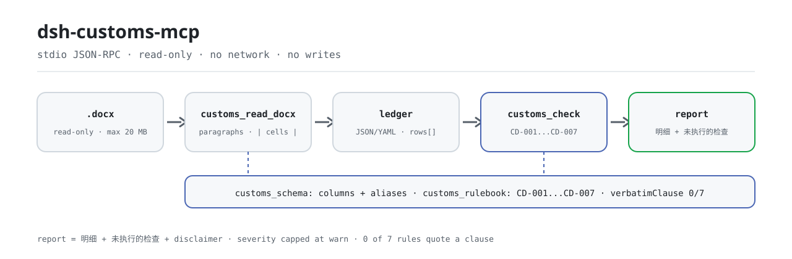

<div align="center">

<picture>
  <source media="(prefers-color-scheme: dark)" srcset="docs/assets/dsh-customs-mcp-flow-dark.svg">
  
</picture>

# dsh-customs-mcp

**把报关单证台账里各行自相矛盾的地方一次挑出来——商品编号不是十位、币制不是三位字母、毛重小于净重、单号重复、日期解析不了、模板占位符没换掉。**

只读 MCP server：吃你手上已有的台账（JSON 或 YAML，一行一张单证或一个商品行），按规则包核对台账自身的格式、算术与齐备性，输出带行号与条款依据的 Markdown 报告；不判断申报是否正确、商品归类是否恰当、是否应当缴税。

[安装](#三步上手) · [配置](#配置) · [FAQ](#faq) · [简体中文](README.md) · [English](README.en.md) · [Español](README.es.md) · [Português](README.pt.md) · [हिन्दी](README.hi.md)

[](LICENSE)
[](https://www.npmjs.com/package/dsh-customs-mcp)
[](#三步上手)

[](https://github.com/PerryLink/dsh-customs-mcp/stargazers)
[](https://www.npmjs.com/package/dsh-customs-mcp)

```sh
npm i -g dsh-customs-mcp   # 全局安装，装完命令即 dsh-customs-mcp
npx -y dsh-customs-mcp     # 或者免安装直接跑
```

</div>

<sub>社区工具，与 DeepSeek 官方无关。唯一仓库：<https://github.com/PerryLink/dsh-customs-mcp>。</sub>

## 它是什么

这个 server 只做一件事：拿一份你已经整理好的报关台账，逐行核对它跟自己有没有矛盾。输入是台账本身（`{ "rows": [...] }` 或裸数组，JSON / YAML 都行），输出是一份 Markdown 报告——每条命中都带行号、字段名、实际值、依据要求、条款依据与建议核对方向，报告末尾永远有一段「未执行的检查」，把没跑的规则和原因列清楚。

它不判断申报是否真实、归类是否恰当、是否应当缴税。这些是海关与归类专业人员的判断，也是这个工具刻意不做的部分。

## 三步上手

### 1. 安装

```sh
npm i -g dsh-customs-mcp     # 全局安装：命令为 dsh-customs-mcp
npx -y dsh-customs-mcp       # 或免安装：由 npx 直接拉起
```

运行时零依赖（`package.json` 里没有 `dependencies`），Node ≥ 18，不需要凭据、不联网、不写文件。装完即可给任意 MCP 客户端使用。

### 2. 快速用法

写进客户端配置（以 npx 形式为例）：

```json
{
  "mcpServers": {
    "customs": {
      "command": "npx",
      "args": ["-y", "dsh-customs-mcp"]
    }
  }
}
```

接上之后的建议顺序是：`customs_schema` 对一遍列名 → 把台账贴进去 → `customs_check` 出报告。`.docx` 先过一遍 `customs_read_docx` 取文，再整成台账。

### 3. 验证

```sh
printf '%s\n' '{"jsonrpc":"2.0","id":1,"method":"initialize","params":{}}' | npx -y dsh-customs-mcp
```

```
{"jsonrpc":"2.0","id":1,"result":{"protocolVersion":"2024-11-05","capabilities":{"tools":{}},"serverInfo":{"name":"dsh-customs-mcp","version":"0.1.0"}}}
```

再发 `tools/list` 应看到四个工具；发 `customs_rulebook` 应看到 `"verbatimClause": 0`。Windows 下不必手打 JSON-RPC——按上一步写进客户端配置即可。

*Observed from `src/index.js:9-23`（stdio 传输）, `src/server.js:139-154`（initialize 应答）*

## 核心能力

### 四个工具

| 工具 | 入参 | 返回 | 做什么 |
|---|---|---|---|
| `customs_check` | `material`（JSON/YAML 文本，必填）、`onlyRules`（可选规则 ID 数组） | Markdown 报告 | 用规则包核对台账，返回命中清单 + 未执行的检查 |
| `customs_read_docx` | `path`（`.docx` 路径，必填） | 纯文本 | 段落逐行、表格行拆成竖线分隔的单元格，合并单元格标记 `↔` |
| `customs_schema` | 无 | JSON | 17 个行字段 + 5 个表头字段，以及每个字段接受的全部别名 |
| `customs_rulebook` | 无 | JSON | 7 条规则（id / 标题 / 严重级 / 依据性质 / 引文来源）+ `coverage` |

四个工具都声明 `readOnlyHint: true`、`destructiveHint: false`、`openWorldHint: false`。

### 七条规则

| ID | 查什么 | 规则包声明的判据 | 严重级 |
|---|---|---|---|
| `CD-001` | 品名与总价至少填了一个 | `presenceAny: goodsName, amount` | 提示 |
| `CD-002` | 商品编号是十位数字 | `pattern: ^[0-9]{10}$` | 提示 |
| `CD-003` | 币制是三位大写字母 | `pattern: ^[A-Z]{3}$` | 提示 |
| `CD-004` | 单证编号在台账内唯一 | `unique: docNo`（比较时忽略空白） | 提示 |
| `CD-005` | 毛重不小于净重 | `grossWeight >= netWeight`（可带单位，如 `12.5KGS`） | 提示 |
| `CD-006` | 申报日期可解析，且不晚于核对日 | `date: declaredAt, notAfter: today` | 提示 |
| `CD-007` | 品名不含未替换的占位符 | `containsAny`：`【`、`】`、`{{`、`}}`、`XXX`、`待填`、`TBD`、`示例` 等 11 个词 | 提示 |

规则数据与代码分离：判据是规则包里的一份 YAML 参数，改位数、改正则、改占位符清单都不必动代码。

### 报告怎么读

- 开头四行：检查对象 / 检查时间 / 规则集版本 / 结果统计（错误 · 提示 · 参考）。
- `## 明细`：每条命中带 `实际`、`依据要求`、`条款依据`、`建议核对`、`编号`；编号由规则 id 加定位哈希组成，同一处命中稳定复现。
- `## 未执行的检查`：材料不足或前置条件不满足的规则逐条列出原因。这一节永远出现——报告只在这份清单允许的范围内成立。
- 结尾免责声明：程序按声明的规则集生成，只列与所引条款之间的字面差异，供人工复核线索使用。
- **措辞闸门**：渲染器里有一张禁用词表（`合规`、`违规`、`违法`、`通过验收` 之类），报告文本一旦出现裁定性措辞就直接抛错、不出报告。

### 诚实的那部分

规则包为每条规则写明它依据什么，而**7 条里目前有 0 条持有逐字条文**。这一点是规则包自己写的：这类规则的 `excerpt` 写的是「该条文本次未取得」，而不是转述一份作者没能读到的法规。

`customs_rulebook` 把覆盖率作为**算出来的数字**给出，不是作为一句声明：

```json
"coverage": {
  "rules": 7,
  "verbatimClause": 0,
  "uncited": 7,
  "bySeverity": { "warn": 7 },
  "byBasisKind": { "derived-from-principle": 7 }
}
```

`verbatimClause: false` 只表示规则包声明它没拿到条文正文，**不表示这条检查没有依据**；本 server 也不会把一条推论来的规则升格成明文规则。所以这些检查是形式与算术上的一致性，严重级封顶 `warn`，报告会明确标出哪几条根本没有执行。

### 示例

输入（一行台账；`test/fixtures/ledger-bad.json` 里另有一份三行坏样本）：

```json
{
  "declarationNo": "530120260000123456",
  "rows": [
    { "单证编号": "INV-2026-001", "商品编号": "84713000", "品名": "笔记本电脑",
      "总价": "50000", "币制": "USD", "毛重": "10", "净重": "12", "申报日期": "2026-02-31" }
  ]
}
```

输出（`## 明细` 部分；`条款依据`、`建议核对`、`编号` 三行此处省略）：

```
- **[提示] CD-002** — 第1行数据
  - 实际：第 1 行「hsCode」的值「84713000」不符合配置的形式
  - 依据要求：「hsCode」应匹配 ^[0-9]{10}$

- **[提示] CD-005** — 第1行数据
  - 实际：第 1 行「grossWeight」为 10，「netWeight」为 12，不满足不小于关系
  - 依据要求：「grossWeight」应不小于「netWeight」

- **[提示] CD-006** — 第1行数据
  - 实际：第 1 行「declaredAt」的值「2026-02-31」无法解析为日期
  - 依据要求：「declaredAt」应为 2026-03-15 或 2026-03-15 09:30 这样的可解析日期
```

*Observed from `src/check.mjs:2597-2664`（报告渲染器）, `src/check.mjs:2666-2672`（严重级与依据性质的上限）*

## 配置

这个 server 没有配置文件、没有环境变量、没有可调开关。能配的只有两处：MCP 客户端里的启动命令，和工具入参。

| 参数 | 归属 | 默认 / 取值 | 说明 |
|---|---|---|---|
| `material` | `customs_check` | 必填，非空字符串 | 台账正文，JSON 或 YAML；`{ "rows": [...] }` 或裸数组 |
| `onlyRules` | `customs_check` | 省略 = 7 条全跑 | 只跑指定规则 id，如 `["CD-002"]`；被排除的规则会进「未执行的检查」 |
| `path` | `customs_read_docx` | 必填，须以 `.docx` 结尾 | 绝对路径或相对工作目录；只读打开这一个文件 |
| 启动命令 | 客户端配置 | `npx -y dsh-customs-mcp` 或全局 `dsh-customs-mcp` | stdio 传输，换行分隔的 JSON-RPC |
| 协议版本 | `initialize` | `2024-11-05` | 应答里的 `protocolVersion` |
| 单文件上限 | `customs_read_docx` | 20 MB | 超过即拒收，报出实际大小 |
| 环境变量 / 凭据 | — | 无 | 不读凭据，不发网络请求 |
| 写入 | — | 无 | 只读打开传入路径；`src/` 里没有写文件调用 |

<details>
<summary>完整列名契约（17 个行字段 + 5 个表头字段，含全部别名）</summary>

行字段（每行一个对象；字段命中任一别名即算识别）：

| 字段 | 接受的列名 | 用途 |
|---|---|---|
| `docKind` | `单证种类`、`单证类型`、`单据名称`、`docKind`、`document` | 单证类型 |
| `docNo` | `单证编号`、`编号`、`发票号`、`合同号`、`docNo`、`number` | 单证编号（`CD-004` 查唯一） |
| `hsCode` | `商品编号`、`HS编码`、`税则号列`、`hsCode`、`hs` | 商品编号（`CD-002` 查十位） |
| `goodsName` | `商品名称`、`品名`、`货名`、`goodsName`、`goods` | 品名（`CD-001`、`CD-007`） |
| `quantity` | `数量`、`成交数量`、`quantity`、`qty` | 数量 |
| `unit` | `单位`、`计量单位`、`成交计量单位`、`unit` | 计量单位 |
| `unitPrice` | `单价`、`成交单价`、`unitPrice`、`price` | 单价 |
| `amount` | `总价`、`成交总价`、`金额`、`amount`、`total` | 总价（`CD-001`） |
| `currency` | `币制`、`币种`、`currency` | 币制（`CD-003` 查三位） |
| `tradeTerms` | `成交方式`、`贸易术语`、`价格条件`、`tradeTerms`、`terms` | 成交方式 |
| `origin` | `原产国`、`原产国地区`、`起运国`、`origin` | 原产国 |
| `destination` | `最终目的国`、`运抵国`、`destination` | 最终目的国 |
| `grossWeight` | `毛重`、`grossWeight` | 毛重（`CD-005`） |
| `netWeight` | `净重`、`netWeight` | 净重（`CD-005`） |
| `packages` | `件数`、`包装件数`、`packages` | 件数 |
| `declaredAt` | `申报日期`、`日期`、`declaredAt`、`date` | 申报日期（`CD-006`） |
| `note` | `备注`、`说明`、`note`、`remark` | 备注 |

表头字段（整份台账级别的标量，可被行内同名字段覆盖）：

| 字段 | 接受的键名 |
|---|---|
| `declarationNo` | `declarationNo`、`报关单号`、`提单号` |
| `consignee` | `consignee`、`境内收货人`、`收发货人`、`经营单位` |
| `contractNo` | `contractNo`、`合同号`、`合同协议号` |
| `invoiceNo` | `invoiceNo`、`发票号` |
| `declaredAt` | `declaredAt`、`申报日期` |

行列表键：`rows` / `items` / `documents` / `单证`，命中任一即可。整份台账至少要有 `报关单号`、`declarationNo`、`单证编号`、`docNo`、`商品编号`、`hsCode`、`商品名称`、`goodsName` 之一，否则直接报错并列出实际列名。

</details>

## FAQ

<details>
<summary>台账会不会离开本机？</summary>

不会。`src/` 里没有 `node:http` / `node:https` / `node:net` / `node:dgram` / `fetch(`，也没有 `writeFile` / `appendFile` / `createWriteStream` / `rm(` / `unlink`——这条「无网络、无写入」的声明由 `test/smoke.mjs` 对**实际发布的源码**逐个文件静态校验，不是文档里的自我声明。报告只出现在客户端会话里。

</details>

<details>
<summary>7 条规则一条都没拿到条文原文，这份报告还算依据吗？</summary>

算「线索」，不算「结论」。规则包把每条规则的依据性质写死为 `derived-from-principle`（原则性条款推论），因此严重级封顶 `warn`，永远到不了 `error`；`customs_rulebook` 的 `coverage` 把「持有逐字条文 0 条 / 未取得 7 条」作为算出来的数字给出。报告末尾的「未执行的检查」再说明哪几条没跑。三者叠加的效果是：你能知道每条命中基于什么、有多弱、以及有什么没被检查。

</details>

<details>
<summary>为什么 PDF、.doc、.wps 直接拒收？</summary>

PDF 会丢掉表格的单元格结构，重建出来的台账错在哪里，核对本身查不出来——这比不查更危险，所以故意拒收。`.doc` / `.wps` 是另一种二进制格式，本 server 不解析。只接受以 `.docx` 结尾的路径，先转换再喂进来。

</details>

<details>
<summary>列名写错了会怎样？</summary>

分两种。整份台账没有任何可识别字段时，直接报错并列出「已识别的列名」与「已按以下名称查找」；只有部分列名写错时，写错的那些列会被静默丢弃，对应规则不出声——报告不会替它喊「没查到」。所以先调一次 `customs_schema`，它给的是引擎自己的契约，不是文档抄来的。

</details>

<details>
<summary>会不会给出「合规 / 违规」这类结论？</summary>

不会，而且是硬性拦住：渲染器逐字扫描报告文本，命中禁用词表（`合规`、`违规`、`违法`、`通过验收` 等）就抛错、不出报告；引号与书名号内的引文不计入判定。报告结尾附免责声明，写明它只列字面差异、不构成定性意见。

</details>

## 已知限制

- **全部封顶 `warn`，0 条持有逐字条文。** 这是规则包当前的真实状态，不是配置项；`customs_rulebook` 每次都会把它算出来报给你。
- **不内置任何代码表。** 关区、币制、国别、港口、运输方式、监管方式的代码表本次均未取得，因此 `CD-003` 只核对「三位大写字母」这一形态，不判断 `CNY` 与 `RMB` 哪个该用。
- **未识别的列名静默丢弃。** 只错一部分列名时不会报错，只是对应规则不出声（见 FAQ）。
- **只吃表。** 台账得你自己整理成 JSON / YAML；本 server 不做 OCR、不做 PDF 解析、不做归并。
- **不判断实质结论。** 申报是否真实、归类是否正确、是否应当缴税、是否在法定期限内，一律不做判断。

### 安全边界

- 只吃表：输入是你已经有的台账，JSON 或 YAML。
- `.docx` 由 `customs_read_docx` 支持；`.doc`/`.wps` 是另一种二进制格式，PDF 是**故意拒收**的——PDF 会丢掉单元格结构，重建出来的台账错在哪里，核对本身查不出来。
- 引擎、规则包、表结构都编译进 `src/check.mjs`，所以这个包运行时不安装任何东西。
- 只读：只打开你给的那一个 `.docx` 路径，只读模式，超过 20 MB 直接拒收。不联网、不写文件、不需要凭据。

## 开发

```sh
git clone https://github.com/PerryLink/dsh-customs-mcp.git
cd dsh-customs-mcp

node test/smoke.mjs                                # 冒烟：协议面 / 四个工具 / 清单一致 / 无网络无写入
node src/check.mjs --schema                        # 列名契约与全部别名
node src/check.mjs --rulebook                      # 规则清单 + coverage
node src/check.mjs test/fixtures/ledger-bad.json   # 命中 6 条，退出码 1；--json 出结构化报告

python scripts/gen-readme-assets.py                # 重新生成 docs/assets 的深浅双版流程图（需 Pillow）
docker build -t dsh-customs-mcp .                  # 可选：node:22-alpine 镜像，入口 src/index.js
```

没有 `npm install`，也没有构建步骤：仓内零依赖，`src/` 即发布产物。README 配图由 [`scripts/gen-readme-assets.py`](scripts/gen-readme-assets.py) 程序化生成（Pillow + CJK 字体探测，图内只有命令 token），可重复执行。

目录布局：

```
src/index.js     stdio 传输：换行分隔的 JSON-RPC 循环
src/server.js    协议面与四个工具（initialize / tools/list / tools/call）
src/check.mjs    引擎、规则包、表结构（打包进单文件，导出 COLUMN_CONTRACT / rulebook / renderMarkdown）
src/docx.mjs     .docx 取文：段落逐行、表格行、合并单元格标记
test/smoke.mjs   冒烟测试：清单一致、协议应答、四个工具、拒收路径、无网络无写入
server.json      MCP registry 清单（name/version 与 package.json 对齐）
scripts/gen-readme-assets.py  README 配图生成
docs/assets/     深浅双版流程图
```

## 家族与致谢

本项目由 [PerryLink](https://github.com/PerryLink) 维护（Apache-2.0），与同族的报关单证核对工具线共用一套检查引擎：`src/check.mjs` 就是从 `dsh-customs-doc-check` 打包进来的（规则包头部写着 `plugin: dsh-customs-doc-check`，源文件也保留着来源注释），本仓另加 MCP 协议面、`.docx` 只读取文与 npm 分发形态。如果这个 server 帮到了你，**给个 star**——它不解锁任何功能，但会让下一个人更容易找到它。

- [@PerryLink](https://github.com/PerryLink) —— 创建者与维护者：MCP 协议面、`.docx` 只读取文、规则包与表结构打包、清单一致性冒烟测试、五语文档。

## License

[LICENSE](LICENSE)（Apache License 2.0）© 2026 dsh-customs-mcp contributors

<p align="center"><sub>Apache-2.0 · 社区工具，与 DeepSeek 无关。</sub></p>
