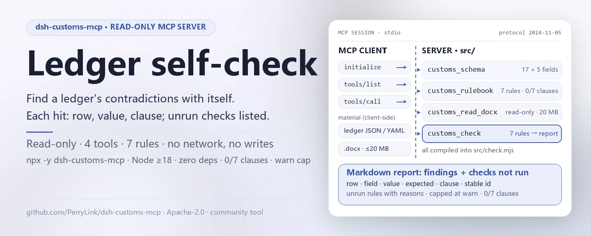
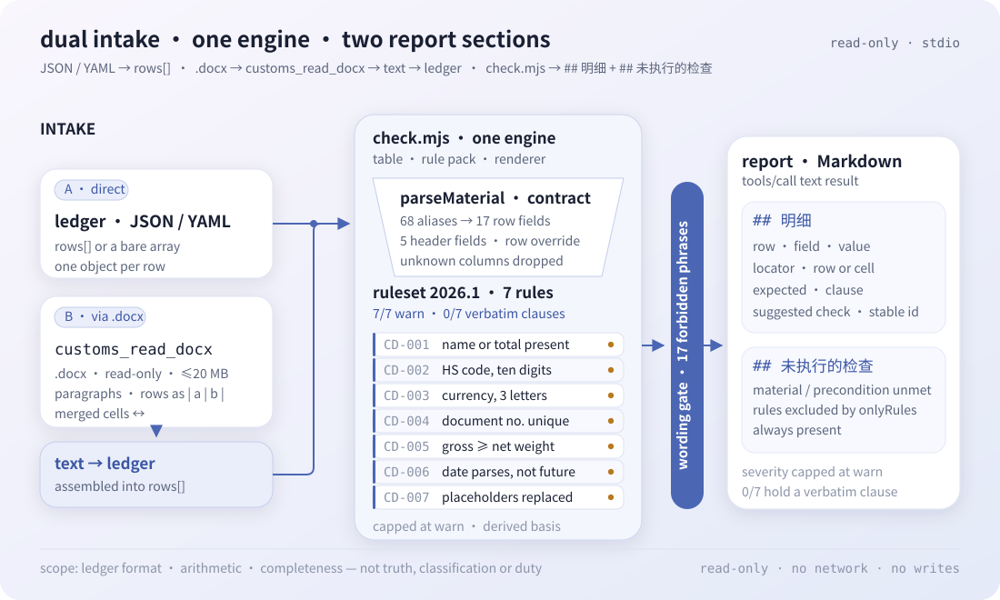

<div align="center">

<picture>
  <source media="(prefers-color-scheme: dark)" srcset="docs/assets/dsh-customs-mcp-hero-en-dark.webp">
  
</picture>

# dsh-customs-mcp

**Extraia de uma vez todas as contradições entre linhas de um livro de declarações aduaneiras: um código HS que não tem dez dígitos, uma moeda que não são três letras, peso bruto menor que o líquido, número de documento repetido, data que não se interpreta, marcador de modelo não preenchido.**

Servidor MCP somente leitura: recebe o livro que você já mantém (JSON ou YAML, uma linha por documento ou por item de mercadoria), confere o próprio formato, a aritmética e a completude desse livro contra um pacote de regras e devolve um relatório Markdown com número de linha e procedência da cláusula. Não decide se a declaração está correta, se a classificação é adequada nem se há tributo a pagar.

[Instalar](#instalação-em-três-passos) · [Configuração](#configuração) · [FAQ](#faq) · [简体中文](README.md) · [English](README.en.md) · [Español](README.es.md) · [Português](README.pt.md) · [हिन्दी](README.hi.md)

[](LICENSE)
[](https://www.npmjs.com/package/dsh-customs-mcp)
[](#instalação-em-três-passos)

[](https://github.com/PerryLink/dsh-customs-mcp/stargazers)
[](https://www.npmjs.com/package/dsh-customs-mcp)

```sh
npm i -g dsh-customs-mcp   # instalação global; o comando é dsh-customs-mcp
npx -y dsh-customs-mcp     # ou rodar sem instalar nada
```

</div>

<sub>Ferramenta da comunidade, sem vínculo com a DeepSeek. Repositório canônico: <https://github.com/PerryLink/dsh-customs-mcp>.</sub>

## O que é

O servidor faz uma coisa só: pega um livro aduaneiro que você já montou e confere, linha por linha, se o livro contradiz a si mesmo. A entrada é o próprio livro (`{ "rows": [...] }` ou um array simples; JSON e YAML valem igual). A saída é um relatório Markdown em que cada achado traz número de linha, nome do campo, valor encontrado, o que a verificação esperava, a cláusula em que se apoia e uma sugestão de onde olhar; o relatório sempre termina com uma seção que lista as verificações que não rodaram e por quê.

Não decide se uma declaração é verdadeira, se uma classificação está correta nem se há tributo a pagar. Isso cabe à aduana e aos especialistas em classificação, e não decidir é deliberado.

<picture>
  <source media="(prefers-color-scheme: dark)" srcset="docs/assets/dsh-customs-mcp-flow-v5-dark.svg">
  
</picture>

## Instalação em três passos

### 1. Instalar

```sh
npm i -g dsh-customs-mcp     # instalação global: o comando é dsh-customs-mcp
npx -y dsh-customs-mcp       # ou sem instalar: o npx executa direto
```

Zero dependências em tempo de execução (não existe chave `dependencies` no `package.json`), Node ≥ 18, sem credenciais, sem rede, sem escritas. Qualquer cliente MCP pode usá-lo depois de instalado.

### 2. Uso rápido

Na configuração do cliente (forma com npx):

```json
{
  "mcpServers": {
    "customs": {
      "command": "npx",
      "args": ["-y", "dsh-customs-mcp"]
    }
  }
}
```

A ordem que funciona: `customs_schema` para confirmar os nomes de coluna, colar o livro e então `customs_check` para o relatório. Com um `.docx`, primeiro `customs_read_docx` para obter texto e depois dar forma de livro.

### 3. Verificar

```sh
printf '%s\n' '{"jsonrpc":"2.0","id":1,"method":"initialize","params":{}}' | npx -y dsh-customs-mcp
```

```
{"jsonrpc":"2.0","id":1,"result":{"protocolVersion":"2024-11-05","capabilities":{"tools":{}},"serverInfo":{"name":"dsh-customs-mcp","version":"0.1.0"}}}
```

Envie depois `tools/list` e as quatro ferramentas aparecem; envie `customs_rulebook` e a resposta traz `"verbatimClause": 0`. No Windows não é preciso digitar JSON-RPC à mão: use a configuração do passo anterior.

*Observed from `src/index.js:9-23` (transporte stdio), `src/server.js:139-154` (resposta ao initialize)*

## Capacidades principais

### As quatro ferramentas

| Ferramenta | Entrada | Devolve | O que faz |
|---|---|---|---|
| `customs_check` | `material` (texto JSON/YAML, obrigatório), `onlyRules` (array opcional de ids) | relatório Markdown | Aplica o pacote de regras ao livro e devolve achados mais as verificações não executadas |
| `customs_read_docx` | `path` (caminho `.docx`, obrigatório) | texto puro | Um parágrafo por linha; linhas de tabela saem como células separadas por barras; células mescladas são marcadas `↔` |
| `customs_schema` | nenhum | JSON | Os 17 campos de linha e os 5 de cabeçalho, com todos os apelidos aceitos |
| `customs_rulebook` | nenhum | JSON | As 7 regras (id / título / severidade / tipo de fundamento / fonte citada) mais `coverage` |

As quatro declaram `readOnlyHint: true`, `destructiveHint: false` e `openWorldHint: false`.

### As sete regras

| ID | O que verifica | Verificação declarada | Severidade |
|---|---|---|---|
| `CD-001` | Há ao menos nome da mercadoria ou valor total | `presenceAny: goodsName, amount` | warn |
| `CD-002` | O código HS tem dez dígitos | `pattern: ^[0-9]{10}$` | warn |
| `CD-003` | A moeda são três letras maiúsculas | `pattern: ^[A-Z]{3}$` | warn |
| `CD-004` | O número de documento é único no livro | `unique: docNo` (ignora espaços) | warn |
| `CD-005` | O peso bruto não é menor que o líquido | `grossWeight >= netWeight` (aceita unidades, ex. `12.5KGS`) | warn |
| `CD-006` | A data de declaração se interpreta e não é posterior à data de conferência | `date: declaredAt, notAfter: today` | warn |
| `CD-007` | O nome da mercadoria não guarda marcador não preenchido | `containsAny`: 11 termos como `XXX`, `TBD`, `{{`, `}}` | warn |

Dados e código são separados: cada verificação é um bloco de parâmetros do pacote de regras, então mudar o número de dígitos, o padrão ou a lista de marcadores não exige mexer em código.

### Como ler o relatório

- Quatro linhas de cabeçalho: material conferido, data da conferência, versão do conjunto de regras e contagem (erro · aviso · referência).
- A seção de achados: cada um traz o encontrado, o esperado, a cláusula em que se apoia, uma sugestão e um id de ocorrência formado pelo id da regra mais um hash de localização; o mesmo achado reproduz o mesmo id.
- A seção de verificações não executadas: cada regra que não rodou aparece com o motivo. Essa seção está sempre presente; o relatório só é tão completo quanto essa lista permite.
- Um aviso final: o relatório é gerado por programa a partir de um conjunto de regras declarado, lista apenas diferenças literais frente às cláusulas citadas e serve como pista para revisão humana.
- **Uma barreira de redação.** O renderizador varre a própria saída contra uma lista de palavras decisórias proibidas (equivalentes em chinês de *conforme*, *não conforme*, *ilegal*, *passou na inspeção*). Se alguma aparecer, ele lança erro em vez de emitir o relatório.

Os dois títulos de seção são literais em chinês, porque o idioma do relatório é fixo:

```text
## 明细
## 未执行的检查
```

### A parte honesta

Cada regra declara em que se apoia, e **0 das 7 conservam hoje o texto literal da cláusula**. O próprio pacote diz isso: o trecho dessas regras lê «desta vez o texto da cláusula não foi obtido» em vez de parafrasear uma norma que o autor não pôde ler.

`customs_rulebook` informa essa cobertura como um **número calculado**, não como uma afirmação:

```json
"coverage": {
  "rules": 7,
  "verbatimClause": 0,
  "uncited": 7,
  "bySeverity": { "warn": 7 },
  "byBasisKind": { "derived-from-principle": 7 }
}
```

`verbatimClause: false` significa que o pacote declara não ter obtido o texto da cláusula; **não** significa que a verificação não tenha fundamento, e este servidor não promove uma regra derivada a regra literal. Por isso as verificações são de formato e de aritmética, com severidade máxima `warn`, e o relatório nomeia quais não chegaram a rodar.

### Exemplo

Entrada (uma linha; `test/fixtures/ledger-bad.json` traz uma amostra ruim de três linhas):

```json
{
  "declarationNo": "530120260000123456",
  "rows": [
    { "单证编号": "INV-2026-001", "商品编号": "84713000", "品名": "笔记本电脑",
      "总价": "50000", "币制": "USD", "毛重": "10", "净重": "12", "申报日期": "2026-02-31" }
  ]
}
```

Saída (a seção de achados; aqui as linhas de cláusula, sugestão e id foram omitidas):

```
- **[提示] CD-002** — 第1行数据
  - 实际：第 1 行「hsCode」的值「84713000」不符合配置的形式
  - 依据要求：「hsCode」应匹配 ^[0-9]{10}$

- **[提示] CD-005** — 第1行数据
  - 实际：第 1 行「grossWeight」为 10，「netWeight」为 12，不满足不小于关系
  - 依据要求：「grossWeight」应不小于「netWeight」

- **[提示] CD-006** — 第1行数据
  - 实际：第 1 行「declaredAt」的值「2026-02-31」无法解析为日期
  - 依据要求：「declaredAt」应为 2026-03-15 或 2026-03-15 09:30 这样的可解析日期
```

*Observed from `src/check.mjs:2597-2664` (o renderizador do relatório), `src/check.mjs:2666-2672` (o teto de severidade por tipo de fundamento)*

## Configuração

Este servidor não tem arquivo de configuração, nem variáveis de ambiente, nem chaves. Só duas coisas se configuram: o comando de inicialização no cliente MCP e os argumentos das ferramentas.

| Parâmetro | Pertence a | Padrão / valor aceito | Significado |
|---|---|---|---|
| `material` | `customs_check` | obrigatório, string não vazia | O corpo do livro, JSON ou YAML: `{ "rows": [...] }` ou array simples |
| `onlyRules` | `customs_check` | omitido = as 7 regras | Rodar só estes ids, ex. `["CD-002"]`; as excluídas entram na seção de não executadas |
| `path` | `customs_read_docx` | obrigatório, deve terminar em `.docx` | Caminho absoluto ou relativo ao diretório de trabalho; só esse arquivo é aberto, em somente leitura |
| Comando de inicialização | configuração do cliente | `npx -y dsh-customs-mcp` ou `dsh-customs-mcp` global | Transporte stdio, JSON-RPC separado por quebras de linha |
| Versão do protocolo | `initialize` | `2024-11-05` | Devolvida como `protocolVersion` |
| Limite por arquivo | `customs_read_docx` | 20 MB | Acima disso é recusado, informando o tamanho real |
| Variáveis de ambiente / credenciais | — | nenhuma | Nenhuma credencial é lida, nenhuma requisição é feita |
| Escritas | — | nenhuma | O caminho informado é aberto em somente leitura; `src/` não tem chamada de escrita |

<details>
<summary>Contrato completo de colunas (17 campos de linha + 5 de cabeçalho)</summary>

Campos de linha (um objeto por linha; um campo é reconhecido quando qualquer apelido aparece):

| Campo | Contém | Usado por |
|---|---|---|
| `docKind` | tipo de documento | — |
| `docNo` | número do documento | `CD-004` (unicidade) |
| `hsCode` | código HS | `CD-002` (dez dígitos) |
| `goodsName` | nome da mercadoria | `CD-001`, `CD-007` |
| `quantity` | quantidade | — |
| `unit` | unidade de medida | — |
| `unitPrice` | preço unitário | — |
| `amount` | valor total | `CD-001` |
| `currency` | código da moeda | `CD-003` (três letras) |
| `tradeTerms` | condições de comércio | — |
| `origin` | país de origem | — |
| `destination` | país de destino final | — |
| `grossWeight` | peso bruto | `CD-005` |
| `netWeight` | peso líquido | `CD-005` |
| `packages` | número de volumes | — |
| `declaredAt` | data da declaração | `CD-006` |
| `note` | observações | — |

Campos de cabeçalho (escalares do livro inteiro; o valor de linha do mesmo campo tem prioridade):

| Campo | Contém |
|---|---|
| `declarationNo` | número da declaração |
| `consignee` | consignatário doméstico |
| `contractNo` | número do contrato |
| `invoiceNo` | número da fatura |
| `declaredAt` | data da declaração |

A chave da lista de linhas pode ser `rows`, `items`, `documents` ou a palavra chinesa equivalente. O livro precisa conter ao menos um de `declarationNo`, `docNo`, `hsCode` ou `goodsName` (as formas em chinês também contam); caso contrário o leitor recusa e lista os nomes de coluna que realmente viu.

Cada campo também responde a várias grafias, incluindo os cabeçalhos em chinês usados em livros reais. Chame `customs_schema` para a lista exata de apelidos: ele devolve o contrato do próprio motor, não uma cópia mantida em documento.

</details>

## FAQ

<details>
<summary>O livro sai da minha máquina?</summary>

Não. Em `src/` não há `node:http`, `node:https`, `node:net`, `node:dgram` nem `fetch(`, e também não há `writeFile`, `appendFile`, `createWriteStream`, `rm(` ou `unlink`: essa afirmação de «sem rede, sem escritas» é verificada pelo `test/smoke.mjs` sobre o **código publicado**, arquivo por arquivo, em vez de prometida em prosa. O relatório existe apenas dentro da sessão do seu cliente.

</details>

<details>
<summary>Se nenhuma das sete regras guarda o texto da cláusula, o relatório ainda vale algo?</summary>

É um conjunto de pistas, não um veredicto. O pacote fixa o tipo de fundamento de cada regra em `derived-from-principle` (inferido de um princípio), então a severidade máxima é `warn` e nunca chega a `error`; o `coverage` do `customs_rulebook` dá o «0 de 7 com texto literal» como número calculado; e a seção de não executadas lista as regras que não rodaram. Com isso você vê em que cada achado se apoia, quão fraco é e o que não foi verificado.

</details>

<details>
<summary>Por que recusa PDF, .doc e .wps de imediato?</summary>

Um PDF perde a estrutura de células da tabela, então um livro reconstruído fica errado de formas que esta verificação não consegue detectar: pior do que não verificar, e por isso é recusado de propósito. `.doc` e `.wps` são outro formato binário e não são interpretados aqui. Só se aceita um caminho terminado em `.docx`; converta primeiro e depois forneça.

</details>

<details>
<summary>O que acontece se um nome de coluna estiver errado?</summary>

Dois casos. Se o livro não tem nenhum campo reconhecível, o leitor recusa e lista tanto o que viu quanto o que procurava. Se apenas alguns nomes estão errados, essas colunas são descartadas em silêncio e as regras que precisavam delas ficam quietas: o relatório não vai anunciar a lacuna. Por isso chame `customs_schema` antes.

</details>

<details>
<summary>Vai dizer em algum momento que algo é conforme ou ilegal?</summary>

Não, e isso é forçado: o renderizador varre a própria saída e lança erro em vez de emitir um relatório que contenha palavra decisória. Trechos entre aspas e entre títulos de obra ficam fora dessa varredura. O relatório fecha com um aviso declarando que apenas lista diferenças literais e não constitui qualificação dos fatos.

</details>

## Limitações conhecidas

- **Tudo fica em `warn`, e 0 de 7 regras guardam o texto literal da cláusula.** É o estado atual do pacote de regras, não um ajuste; `customs_rulebook` recalcula isso a cada chamada.
- **Nenhuma tabela de códigos é embutida.** As tabelas de distritos aduaneiros, moedas, países, portos, modos de transporte e regimes de supervisão não foram obtidas, e por isso `CD-003` verifica a *forma* (três letras maiúsculas) e não escolhe entre `CNY` e `RMB`.
- **Nomes de coluna não reconhecidos são descartados em silêncio.** Um cabeçalho parcialmente errado não gera erro; as regras que precisavam dessas colunas simplesmente não informam (ver FAQ).
- **Somente entrada tabular.** O livro JSON/YAML é montado por você; não há OCR, nem leitura de PDF, nem fusão de documentos.
- **Nenhum juízo substantivo.** Aqui nunca se decide se uma declaração é verdadeira, se uma classificação está correta, se há tributo a pagar ou se um prazo foi cumprido.

### Limites de segurança

- Somente tabelas: a entrada é um livro que você já tem, em JSON ou YAML.
- `.docx` é aceito via `customs_read_docx`. `.doc` e `.wps` são outro formato binário, e o PDF é recusado de propósito: uma tabela em PDF perde a estrutura de células e reconstruí-la produz um livro errado de formas que a verificação não detecta.
- O motor, o pacote de regras e a especificação da tabela são compilados em `src/check.mjs`, então o pacote não instala nada em tempo de execução.
- Somente leitura: abre o único caminho `.docx` informado, em modo leitura, e recusa qualquer coisa acima de 20 MB. Sem rede, sem escritas, sem credenciais.

## Desenvolvimento

```sh
git clone https://github.com/PerryLink/dsh-customs-mcp.git
cd dsh-customs-mcp

node test/smoke.mjs                                # fumaça: superfície do protocolo, quatro ferramentas, manifestos, sem rede nem escritas
node src/check.mjs --schema                        # o contrato de colunas e todos os apelidos
node src/check.mjs --rulebook                      # as regras e a cobertura
node src/check.mjs test/fixtures/ledger-bad.json   # 6 achados, código de saída 1; --json para relatório estruturado

python scripts/gen-readme-assets.py                # regenera os hero webp e os SVG de estrutura em docs/assets (Pillow)
docker build -t dsh-customs-mcp .                  # opcional: imagem node:22-alpine, entrada src/index.js
```

Não há `npm install` nem etapa de build: o repositório não tem dependências e `src/` é o que se publica. As imagens do README são geradas por [`scripts/gen-readme-assets.py`](scripts/gen-readme-assets.py) (o Pillow desenha os hero, a estrutura é SVG escrito à mão e há uma sonda de fonte CJK) e o script pode ser executado de novo sem risco.

Estrutura:

```
src/index.js     transporte stdio: laço JSON-RPC separado por quebras de linha
src/server.js    superfície do protocolo e as quatro ferramentas (initialize / tools/list / tools/call)
src/check.mjs    motor, pacote de regras e especificação de tabela em um só arquivo; exporta COLUMN_CONTRACT, rulebook e renderMarkdown
src/docx.mjs     extração de texto .docx: parágrafos, linhas de tabela, marcas de célula mesclada
test/smoke.mjs   teste de fumaça: manifestos, respostas do protocolo, quatro ferramentas, recusas, sem rede nem escritas
server.json      manifesto do registro MCP (name/version alinhados ao package.json)
scripts/gen-readme-assets.py  gerador dos diagramas do README
docs/assets/     hero claro/escuro e diagrama de estrutura
```

## Família e agradecimentos

Mantido por [PerryLink](https://github.com/PerryLink) (Apache-2.0), sobre o mesmo motor de inspeção do verificador irmão de documentos aduaneiros: o `src/check.mjs` é empacotado a partir do `dsh-customs-doc-check` (o cabeçalho do pacote de regras ainda nomeia `plugin: dsh-customs-doc-check` e o código mantém seus comentários de procedência). Este repositório acrescenta a superfície do protocolo MCP, a extração `.docx` somente leitura e a forma de distribuição em npm. Se este servidor te ajudou, **dê uma estrela**: não desbloqueia nada, mas faz a próxima pessoa encontrá-lo.

- [@PerryLink](https://github.com/PerryLink) — criador e mantenedor: a superfície do protocolo MCP, a extração `.docx` somente leitura, o empacotamento do pacote de regras e da especificação de tabela, o teste de fumaça de manifestos e a documentação em cinco idiomas.

## Licença

[LICENSE](LICENSE) (Apache License 2.0) © 2026 dsh-customs-mcp contributors

<p align="center"><sub>Apache-2.0 · Ferramenta da comunidade, sem vínculo com a DeepSeek.</sub></p>
